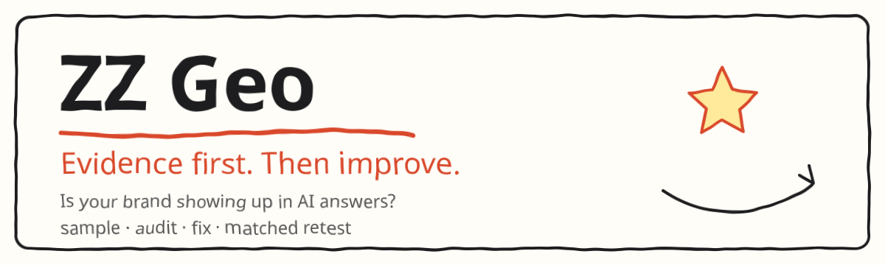
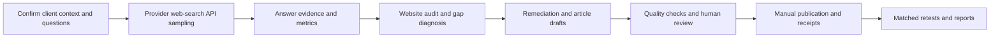
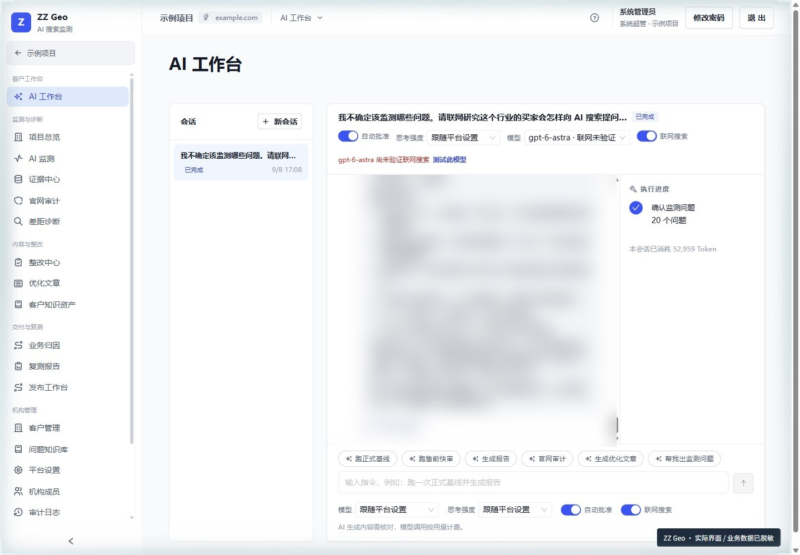
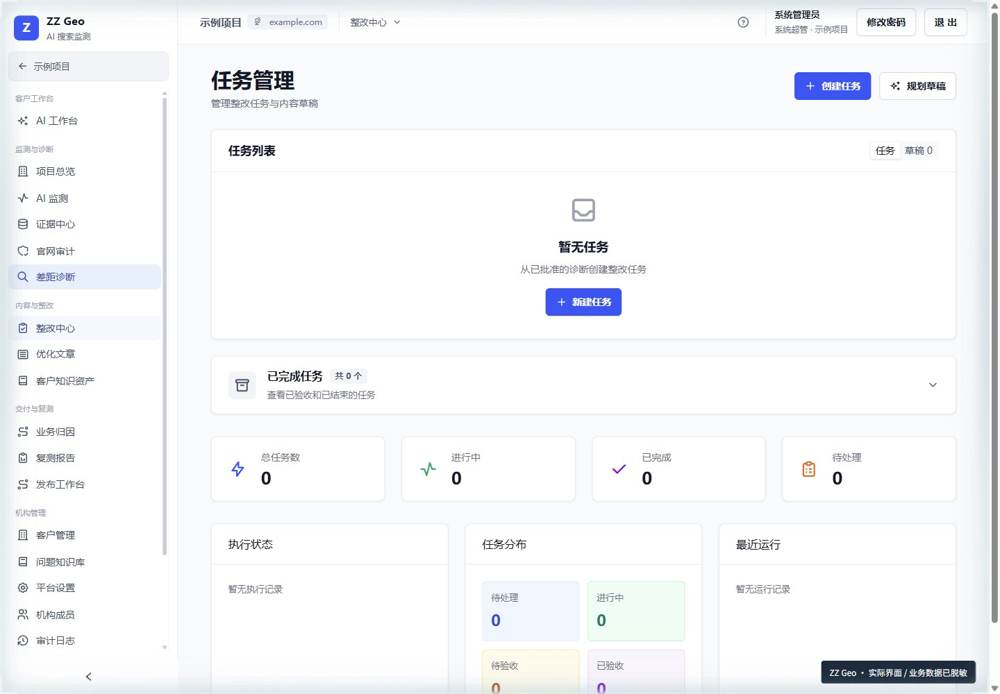
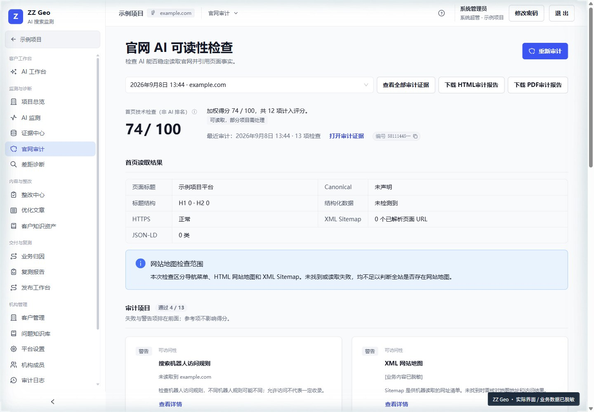
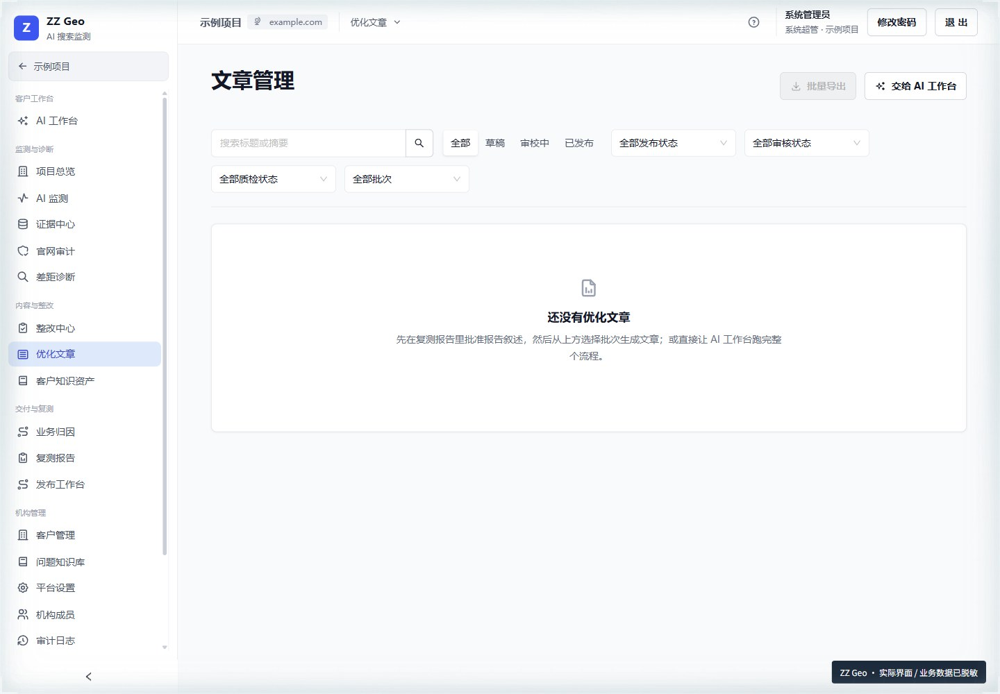

<div align="center">

<picture>
  <source media="(prefers-color-scheme: dark)" srcset="docs/assets/hero.svg">
  
</picture>

### An evidence-led GEO workspace for brand teams

**Is your brand showing up in AI answers? Sample, keep the evidence, fix the gaps, then retest under matched conditions.**

[](LICENSE.md)
[](#local-source-development)
[](#local-source-development)
[](docs/search-provider-adapters.md)
[](docs/user-guide.md)
[](docs/docker-quickstart.md)

**[Quick start](#-quick-start) · [Capabilities](#-capabilities) · [Docs](#-documentation) · [Interactive demo](https://www.honesttai.com/interactive/preview.html)**

**English** · [简体中文](README.zh-CN.md)

</div>

> Sampling uses provider APIs, **not consumer-app answers**. Matched retests support comparison, **not causal proof**. No guarantee of inclusion or ranking is made.

## ❤️ Sponsor

| Sponsor | What it is |
| :--- | :--- |
| [](https://hrouter.net/home) | **[HRouter](https://hrouter.net/home)**: model access, API key management, and usage tracking for AI coding and application development. Also operated by the maintainer. |

## ✨ Why use it

**🔎 Evidence first.** Original answers, frozen configuration, sources, approvals, and report snapshots stay available for verification. Failures and unknowns are **never filled with synthetic data**.

**🔁 Closed loop.** One workspace covers client research, sampling, website audits, remediation, content review, and matched retests, so every change traces back to a concrete question.

**🏠 Yours to run.** Self-hosted under AGPL-3.0-only. Client data, credentials, and databases stay on your infrastructure.

## 🧭 From questions to evidence



## 🖼️ Interface preview

| AI workbench | Remediation center |
| :--- | :--- |
|  |  |
| **Website audit** | **Article improvements** |
|  |  |

Screenshots show the actual interface as of September 9, 2026, with sensitive business data removed and empty states preserved. They are not proof of customer outcomes. See the [illustrated user guide](docs/user-guide.md).

## 🧩 Capabilities

| Area | How it works |
| :--- | :--- |
| Client and question research | Manage clients, competitors, brand aliases, and candidate questions; members confirm the monitoring scope |
| Multi-provider sampling | DeepSeek, Kimi, Doubao / Volcengine Ark, Qwen DashScope, and Yuanbao search sources with Hunyuan synthesis |
| Evidence and metrics | Preserve original answers, distinguish search sources from final citations, and explain mentions, explicit recommendations, and valid denominators |
| Website audits and remediation | Retain page sources, screenshots, and evidence; create traceable, assignable tasks with acceptance criteria |
| Agent workbench | Organize work in natural language with project-scoped controlled tools and human approval of structured drafts where required |
| Content operations | Maintain knowledge revisions, article versions, review, quality gates, and manual publication receipts |
| Retesting and reports | Reuse the full baseline configuration; freeze report snapshots and generate online reports, PDF, and Word |
| Team collaboration | Organization, role, and client-scoped access with audit and execution logs |

The Yuanbao channel combines Yuanbao search sources with Hunyuan synthesis. Reusing sampling configuration reduces condition differences; it does not independently establish the causal effect of content changes.

## 🚀 Quick start

### 1. Run with Docker

Follow [Docker quick start](docs/docker-quickstart.md):

```bash
bash docker/quickstart/start.sh
```

On Windows: `powershell -ExecutionPolicy Bypass -File docker/quickstart/start.ps1`. The script asks for an administrator email, generates random keys, and starts nine services.

### 2. Configure providers

Sign in, set up providers and the HRouter model in platform settings, then define clients and question scopes. Collection, connectivity checks, and model calls may incur API charges.

### 3. Sample, remediate, retest

Confirm questions, run sampling, review evidence and audits, publish fixes manually, then retest with the baseline configuration.

### Local source development

Requirements: Node.js 24, Corepack, and pnpm 11. Run commands from the complete source root. Use macOS, Linux, or Windows WSL; PGlite is for local development and testing only.

```bash
corepack pnpm install --frozen-lockfile
corepack pnpm --filter @geo/worker exec playwright install chromium
```

macOS stores the master key in the system keychain. On Linux/WSL, securely retain a 32-byte Base64 master key and choose a **new, separate data directory**:

```bash
export GEO_DATA_DIR="$PWD/.geo-data"
# Generate only for first-time initialization. Retain and reuse this exact key.
export GEO_MASTER_KEY="$(node -e "process.stdout.write(require('node:crypto').randomBytes(32).toString('base64'))")"
corepack pnpm geo setup
corepack pnpm geo start
```

Startup prints the local workbench address on port 3000. Make sure `DATABASE_URL` does not point to an existing external database; for first-time use, leave it unset and use a new PGlite database. **Do not regenerate the master key on every restart**: saved provider credentials would become unreadable. Native Windows process invocation has limitations; WSL is recommended.

See [deployment](docs/deployment.md) for server installation, backups, updates, and rollback.

## 📚 Documentation

Detailed guides are primarily in Chinese; use the language switch for the original project introduction.

- **[User guide](docs/user-guide.md)**: 21 chapters and 20 actual interface screenshots.
- **[Architecture](docs/architecture.md)**: services, evidence, and data boundaries.
- **[Measurement definitions](docs/visibility-measurement-v2.md)**: denominators, aggregation, and comparison conditions.
- **[Provider adapters](docs/search-provider-adapters.md)**: API and collection contracts.
- **[Deployment](docs/deployment.md) · [Operations](docs/operations.md)**: installation, recovery, troubleshooting.
- **[Contributing](CONTRIBUTING.md)**: contribution and verification requirements.

Before sending a change, run:

```bash
corepack pnpm check-types
corepack pnpm test
corepack pnpm build
corepack pnpm lint
corepack pnpm license-check
```

## 📄 License, privacy, and services

Project-owned code is licensed under [AGPL-3.0-only](LICENSE.md). Consult the full license for use, modification, distribution, and network-service obligations; third-party code keeps its licenses in [NOTICE](NOTICE) and [THIRD_PARTY_NOTICES.md](THIRD_PARTY_NOTICES.md). Open source does **not** mean publishing client data, accounts, credentials, databases, or original private evidence. Infrastructure, storage, and third-party API costs are yours.

Access to the official evaluation environment is arranged manually; no login address is published here. [Email honest.tai@outlook.com](mailto:honest.tai@outlook.com) with your team, intended use, and workflows to request access or discuss deployment, training, and customization.

## 🧰 More from honestTai

<table>
<tr>
<td width="50%" valign="top">

### [HRouter Desktop](https://github.com/honestTai/HRouter-Desktop)
**Less configuration. More coding.**

A local-first desktop workbench for AI coding agents, providers, keys, profiles, and model routes.

[Download for macOS / Windows →](https://github.com/honestTai/HRouter-Desktop/releases/latest)

</td>
<td width="50%" valign="top">

### [SeeHTML AI](https://github.com/honestTai/seehtml-ai)
**An idea → HTML → a presentation or video.**

Create and refine HTML with AI in a local workspace, preview the result, and export PPTX, images, or MP4.

[Explore the creative workflow →](https://github.com/honestTai/seehtml-ai)

</td>
</tr>
<tr>
<td width="50%" valign="top">

### [Rent Project](https://github.com/honestTai/rent-project)
**From a rental order to fulfillment.**

Products, orders, electronic contracts, installment bills, and operations.

[Take the visual tour →](https://github.com/honestTai/rent-project/blob/main/docs/SHOWCASE.md)

</td>
<td width="50%" valign="top">

### [motion-library](https://github.com/honestTai/motion-library)
**A motion library for video developers.**

152 recipe cards, 209 sample clips, Remotion source, and an agent skill.

[Browse the library →](https://github.com/honestTai/motion-library)

</td>
</tr>
</table>

| Repository | What it does | Type |
| :--- | :--- | :--- |
| [**hrouter-market-pulse**](https://github.com/honestTai/hrouter-market-pulse) | A market research workbench and Codex plugin for A-share, HK, and US markets. | Project |
| [**hrouter-canvas**](https://github.com/honestTai/hrouter-canvas) | Infinite-canvas image generation for coding agents. | Project |
| [**tauri-markdown-reader**](https://github.com/honestTai/tauri-markdown-reader) | Read, search, edit, and export local Markdown to Word or PDF. | Project |

[All public repositories →](https://github.com/honestTai)

---

<div align="center">

Made by **[honestTai](https://github.com/honestTai)** · [HRouter](https://hrouter.net/home) · [More projects](https://github.com/honestTai)

**Star the project if it helps, and share your ideas in Issues.**

</div>

## 📈 Project activity

Star / Fork totals and retained-event history, scheduled to refresh daily.

<a href="https://www.star-history.com/#honestTai/geo-console&Date">
  <picture>
    <source media="(prefers-color-scheme: dark)" srcset="https://api.star-history.com/svg?repos=honestTai/geo-console&type=Date&theme=dark">
    
  </picture>
</a>

[Observed daily totals](https://raw.githubusercontent.com/honestTai/honestTai/main/assets/metrics/geo-console-daily.svg) · [Methodology](https://github.com/honestTai/honestTai/blob/main/data/METHODOLOGY.md)

<sub>Historical curves reconstruct currently retained stars and visible forks, not historical net totals. Separate daily observations start on 2026-10-06; no fabricated backfill.</sub>
