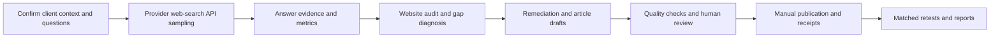

<div align="center">

**English** · [简体中文](README.zh-CN.md)

[HRouter](https://hrouter.net/home) · [All public projects](https://github.com/honestTai) · [Star & Fork trends](#project-activity)

</div>

[](#project-activity)

# ZZ Geo

**Is your brand showing up in AI answers? Find the evidence, then improve.**


An evidence-led workspace for brand mentions, answer sources, website audits, content improvements, and matched retest reports. Built for brand teams, content teams, and GEO service providers.

**Self-hosted · AGPL-3.0-only**

[Interactive demo](https://www.honesttai.com/interactive/preview.html) · [Website](https://www.honesttai.com/) · [Help center](https://www.honesttai.com/help/) · [Quick start](#quick-start)

> Sampling uses provider APIs, **not consumer-app answers**. Matched retests support comparison, **not causal proof**. No guarantee of inclusion or ranking is made.

## From questions to evidence



Original answers, frozen configuration, sources, approvals, and report snapshots remain available for verification. Failures, unknowns, and missing evidence are **not filled with synthetic data**.

## Interface preview

| AI workbench | Remediation center |
| :--- | :--- |
|  |  |
| Website audit | Article improvements |
|  |  |

Screenshots show the actual interface as of September 9, 2026, with sensitive business data removed and empty states preserved. They are not proof of customer outcomes. See the [illustrated user guide](docs/user-guide.md).

## Capabilities

| Area | How it works |
| :--- | :--- |
| Client and question research | Manage clients, competitors, brand aliases, and candidate questions; members confirm the monitoring scope |
| Multi-provider sampling | DeepSeek, Kimi, Doubao / Volcengine Ark, Qwen DashScope, and Yuanbao search sources with Hunyuan synthesis |
| Evidence and metrics | Preserve original answers, distinguish search sources from final citations, and explain mentions, explicit recommendations, and valid denominators |
| Website audits and remediation | Retain page sources, screenshots, and evidence; create traceable, assignable tasks with acceptance criteria |
| Agent workbench | Organize work in natural language with project-scoped controlled tools and human approval of structured drafts where required |
| Content operations | Maintain knowledge revisions, article versions, review, quality gates, and manual publication receipts |
| Retesting and reports | Reuse the full baseline configuration; freeze report snapshots and generate online reports, PDF, and Word |
| Team collaboration | Organization, role, and client-scoped access with audit and execution logs |

The Yuanbao channel combines Yuanbao search sources with Hunyuan synthesis. Reusing sampling configuration reduces condition differences; it does not independently establish the causal effect of content changes.

## Quick start

For a first deployment, follow [Docker quick start](docs/docker-quickstart.md):

```bash
bash docker/quickstart/start.sh
```

On Windows: `powershell -ExecutionPolicy Bypass -File docker/quickstart/start.ps1`. The script asks for an administrator email, generates random keys, and starts nine services.

### Local source development

Requirements: Node.js 24, Corepack, and pnpm 11. Run commands from the complete source root. Use macOS, Linux, or Windows WSL for local development; PGlite is for local development and testing only.

```bash
corepack pnpm install --frozen-lockfile
corepack pnpm --filter @geo/worker exec playwright install chromium
```

macOS stores the master key in the system keychain. On Linux/WSL, securely retain a 32-byte Base64 master key and choose a **new, separate data directory**:

```bash
export GEO_DATA_DIR="$PWD/.geo-data"
# Generate only for first-time initialization. Retain and reuse this exact key.
export GEO_MASTER_KEY="$(node -e "process.stdout.write(require('node:crypto').randomBytes(32).toString('base64'))")"
corepack pnpm geo setup
corepack pnpm geo start
```

Startup prints the local workbench address on port 3000. Before starting, make sure `DATABASE_URL` does not point to an existing external database. For first-time local use, leave it unset and use a new PGlite database. **Do not regenerate the master key on every restart**: existing provider credentials would become unreadable.

Configure providers and the HRouter model in platform settings, then define clients and question scopes. Collection, connectivity checks, and model calls may incur API charges. Native Windows process invocation has limitations; WSL is recommended.

See [deployment](docs/deployment.md) for server installation, backups, updates, and rollback. Operating system, Node, database, and model/API services are required infrastructure.

## Documentation and development

Detailed guides are primarily in Chinese; use the language switch for the original project introduction.

- [User guide](docs/user-guide.md): 21 chapters and 20 actual interface screenshots.
- [Architecture and data boundaries](docs/architecture.md).
- [Measurement definitions](docs/visibility-measurement-v2.md): denominators, aggregation, and comparison conditions.
- [Provider adapters](docs/search-provider-adapters.md): API and collection contracts.
- [Deployment](docs/deployment.md), [operations](docs/operations.md), and [contributing](CONTRIBUTING.md).

```bash
corepack pnpm check-types
corepack pnpm test
corepack pnpm build
corepack pnpm lint
corepack pnpm license-check
```

## License, privacy, and services

Project-owned code is licensed under [AGPL-3.0-only](LICENSE.md). Consult the full license for use, modification, distribution, and network-service obligations; third-party code retains its licenses in [NOTICE](NOTICE) and [THIRD_PARTY_NOTICES.md](THIRD_PARTY_NOTICES.md). Open source does **not** mean publishing client data, accounts, credentials, databases, or original private evidence. Infrastructure, storage, and third-party API costs are yours.

Access to the official evaluation environment is arranged manually; no login address is published here. [Email honest.tai@outlook.com](mailto:honest.tai@outlook.com) with your team, intended use, and workflows to request access or discuss deployment, training, and customization.

Maintained by [honestTai](https://github.com/honestTai), who also operates [HRouter](https://hrouter.net/home).

---

<a id="project-activity"></a>

## Project activity

Star / Fork totals and retained-event history, scheduled to refresh daily.

[](https://github.com/honestTai/honestTai/blob/main/data/README.md)

[Observed daily totals](https://raw.githubusercontent.com/honestTai/honestTai/main/assets/metrics/geo-console-daily.svg) · [Methodology](https://github.com/honestTai/honestTai/blob/main/data/METHODOLOGY.md) · [All public projects](https://github.com/honestTai)

<sub>Historical curves reconstruct currently retained stars and visible forks, not historical net totals. Separate daily observations start on 2026-10-06; no fabricated backfill.</sub>
