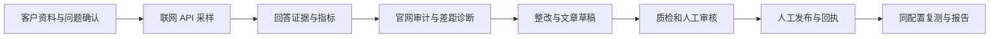
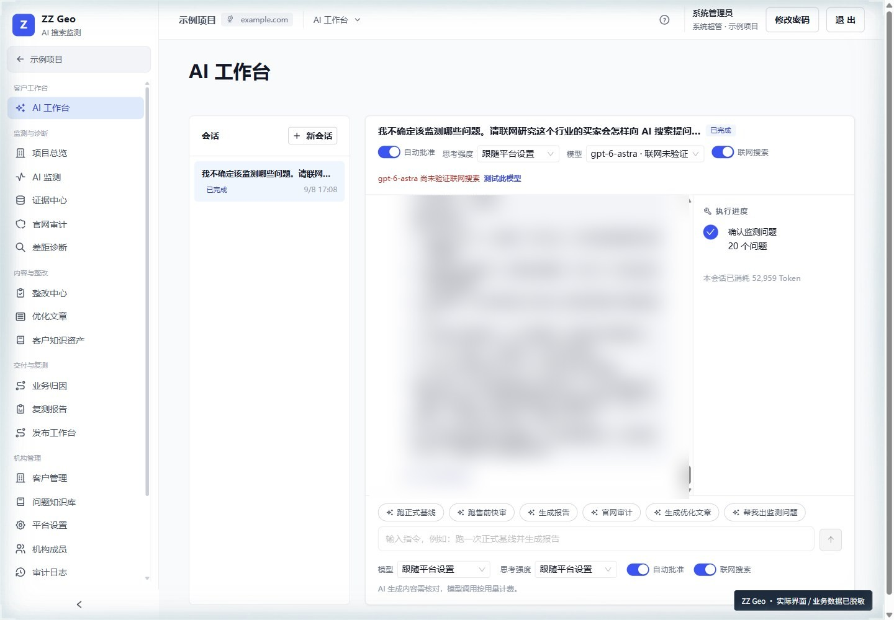
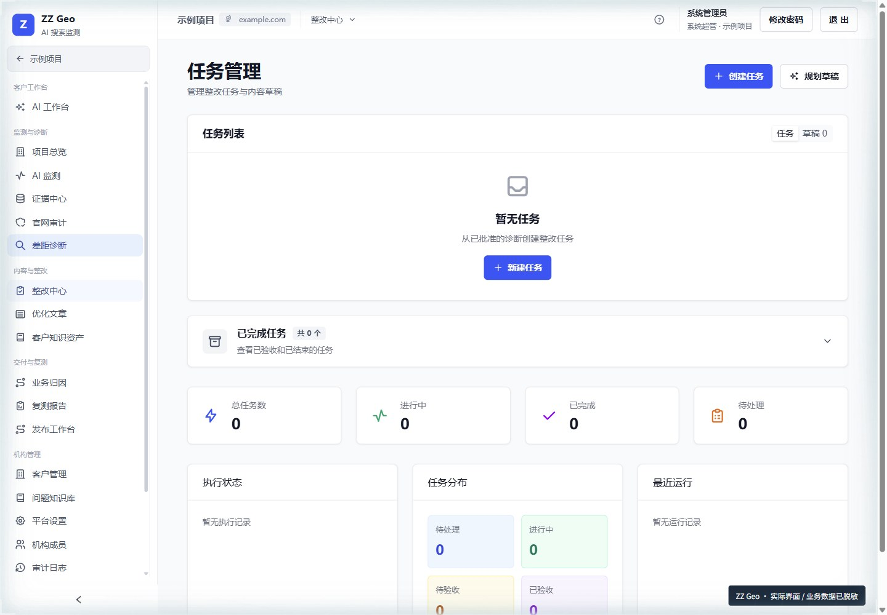
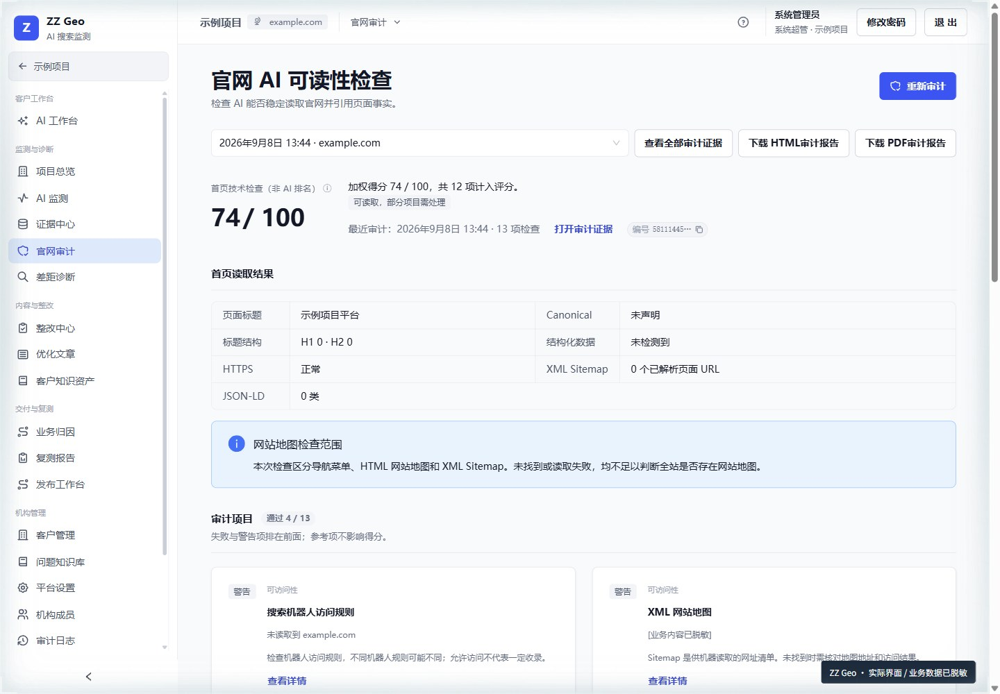
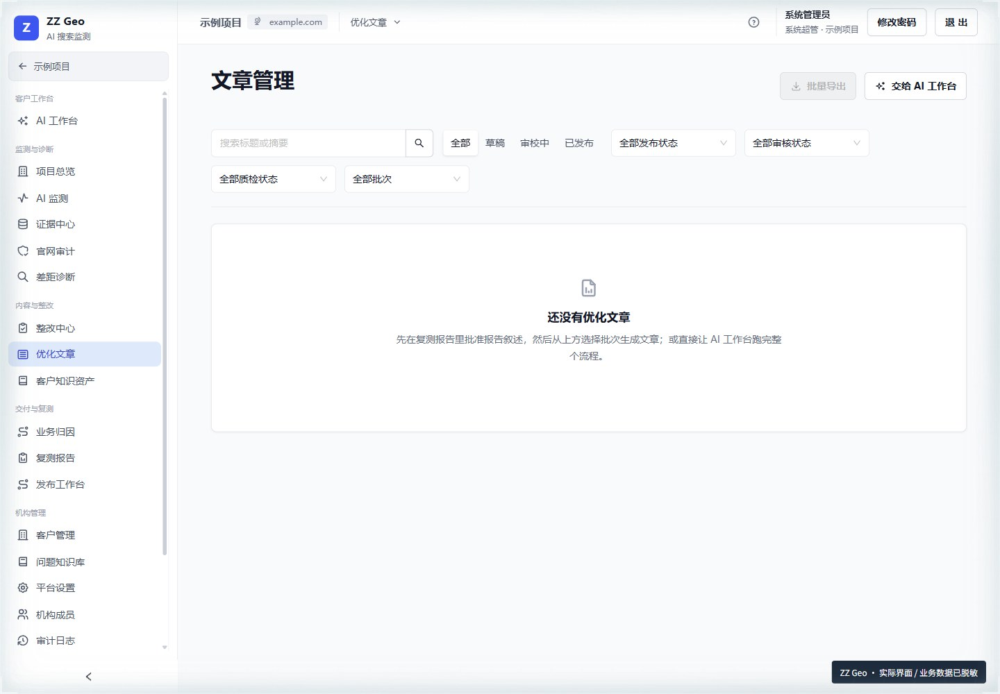

<div align="center">

<picture>
  <source media="(prefers-color-scheme: dark)" srcset="docs/assets/hero.zh-CN.svg">
  
</picture>

### 给品牌团队用的 GEO 证据工作台

**品牌有没有出现在 AI 回答里？先采样留证，再整改，最后同配置复测。**

[](LICENSE.md)
[](#本地源码开发)
[](#本地源码开发)
[](docs/search-provider-adapters.md)
[](docs/user-guide.md)
[](docs/docker-quickstart.md)

**[快速开始](#-快速开始) · [核心能力](#-核心能力) · [开发文档](#-开发文档) · [交互演示](https://www.honesttai.com/interactive/preview.html)**

[English](README.md) · **简体中文**

</div>

> 数据来自供应商联网 API，**不等同于消费端 App 的实际回答**。同配置复测用于比较，**不单独证明整改效果**，不保证收录或排名。

## ❤️ 赞助商

| 赞助商 | 简介 |
| :--- | :--- |
| [](https://hrouter.net/home) | **[HRouter](https://hrouter.net/home)**：面向 AI 编程与应用开发的模型接入、API Key 管理与用量统计，也由作者运营。 |

## ✨ 为什么用它

**🔎 证据优先。** 回答原文、冻结配置、来源、审批与报告快照都可回查。失败、未知和缺失**不会用合成数据补齐**。

**🔁 完整闭环。** 客户研究、采样、官网审计、整改、内容审核到同配置复测，都在同一套工作台里，每次优化都能回到具体问题。

**🏠 自己运行。** AGPL-3.0-only，自行部署。客户数据、密钥和数据库都留在你的基础设施里。

## 🧭 从问题到证据



## 🖼️ 界面预览

| AI 工作台 | 整改中心 |
| :--- | :--- |
|  |  |
| **官网审计** | **优化文章** |
|  |  |

图片来自 2026-09-09 实际系统界面，业务数据已脱敏，空状态如实保留，不构成客户效果证明。更多页面见[图文操作手册](docs/user-guide.md)。

## 🧩 核心能力

| 能力 | 工作方式 |
| :--- | :--- |
| 客户与问题研究 | 管理客户、竞品、品牌别名和问题候选，成员确认正式监测范围 |
| 多平台采样 | DeepSeek、Kimi、豆包火山方舟、通义千问 DashScope、元宝搜索源 + 混元合成 |
| 证据与指标 | 回答原文留档，区分搜索来源和最终引用，解释提及、明确推荐及有效分母 |
| 官网审计与整改 | 保留网页源文件、截图和审计证据，生成可定位、可分配、可验收的任务 |
| Agent 工作台 | 自然语言组织工作，执行项目范围内的受控工具，结构化草稿按要求人工审批 |
| 内容运营 | 客户知识修订、文章版本、内容审核、质检门禁和人工发布回执 |
| 复测与报告 | 复用完整基线配置，冻结报告快照并生成在线报告、PDF 和 Word |
| 团队协作 | 机构、角色和客户范围授权，保留审计与运行日志 |

元宝渠道采用“元宝搜索源 + 混元合成”。同配置复测减少条件差异，但不能单独证明整改的因果效果。

## 🚀 快速开始

### 1. Docker 一键启动

参考 [Docker 一键启动](docs/docker-quickstart.md)：

```bash
bash docker/quickstart/start.sh
```

Windows：`powershell -ExecutionPolicy Bypass -File docker/quickstart/start.ps1`。首次填写管理员邮箱，脚本生成随机密钥并启动九个服务。

### 2. 配置供应商

登录后先在平台设置配置供应商和 HRouter 模型，再建立客户与问题范围。采集、联网测试和模型调用可能产生费用。

### 3. 采样、整改、复测

确认问题并采样，核对证据与审计结果，人工发布整改内容，再用基线配置复测。

### 本地源码开发

要求 Node.js 24、Corepack、pnpm 11。命令在完整源码根目录执行。推荐 macOS、Linux 或 Windows WSL；PGlite 仅用于本地开发与测试。

```bash
corepack pnpm install --frozen-lockfile
corepack pnpm --filter @geo/worker exec playwright install chromium
```

macOS 使用系统钥匙串保存主密钥。Linux/WSL 先提供一个安全保存的 32 字节 Base64 主密钥，并指定**新的独立数据目录**：

```bash
export GEO_DATA_DIR="$PWD/.geo-data"
# 仅首次初始化生成；请安全保存并在后续启动使用同一个值。
export GEO_MASTER_KEY="$(node -e "process.stdout.write(require('node:crypto').randomBytes(32).toString('base64'))")"
corepack pnpm geo setup
corepack pnpm geo start
```

开发工作台默认在本机 3000 端口，启动命令会打印地址。启动前确认没有指向既有外部数据库的 `DATABASE_URL`；首次使用请保持未设置，使用新建 PGlite。**不要每次重启重新生成主密钥**，否则无法解密已保存的供应商凭据。原生 Windows 下进程调用兼容性有限，建议使用 WSL。

服务器部署、备份、更新与回滚见[部署文档](docs/deployment.md)。

## 📚 开发文档

- **[操作手册](docs/user-guide.md)**：21 个章节、20 张实际界面截图。
- **[架构与数据边界](docs/architecture.md)**：服务分工、证据与授权边界。
- **[指标口径](docs/visibility-measurement-v2.md)**：分母、汇总和比较条件。
- **[供应商适配](docs/search-provider-adapters.md)**：API 与采集协议。
- **[部署](docs/deployment.md) · [运维](docs/operations.md)**：服务器安装、恢复与排障。
- **[贡献指南](CONTRIBUTING.md)**：贡献与验证要求。

提交修改前运行：

```bash
corepack pnpm check-types
corepack pnpm test
corepack pnpm build
corepack pnpm lint
corepack pnpm license-check
```

## 📄 开源协议与商业使用

项目自有源码采用 [AGPL-3.0-only](LICENSE.md)，允许依协议使用、修改、部署和商业使用。企业内部业务、客户服务和收费服务本身不会产生购买额外软件许可证的要求。

修改版通过网络与用户交互时，应按 AGPL 第 13 条向这些用户显著提供对应源码的免费获取方式。分发时也需履行适用条款；具体义务以许可证全文为准。第三方代码保留原许可，详见 [NOTICE](NOTICE) 与[第三方声明](THIRD_PARTY_NOTICES.md)。

开源不等于公开客户数据、账号、密钥、数据库和原始采集证据。服务器、存储和第三方 API 费用由使用者承担。

## 🤝 体验与技术服务

官方体验环境采用人工开通方式，不在公开文档中提供登录地址。请说明团队、用途和希望体验的流程，通过 **[honest.tai@outlook.com](mailto:honest.tai@outlook.com?subject=ZZ%20Geo%20申请体验账号)** 私下申请账号。

部署、培训、维护、定制开发及赞助合作也可联系同一邮箱。服务是可选项，不是使用开源功能的前置条件；范围、周期和费用另行约定。

## 🧰 更多项目

<table>
<tr>
<td width="50%" valign="top">

### [HRouter Desktop](https://github.com/honestTai/HRouter-Desktop)
**少配置，多写代码。**

本地优先的桌面工作台，管理 AI 编程 Agent 的供应商、密钥、配置档与模型路由。

[下载 macOS / Windows →](https://github.com/honestTai/HRouter-Desktop/releases/latest)

</td>
<td width="50%" valign="top">

### [SeeHTML AI](https://github.com/honestTai/seehtml-ai)
**一个想法 → HTML → 演示文稿或视频。**

在本地工作区用 AI 创建并打磨 HTML，预览后导出 PPTX、图片或 MP4。

[了解创作流程 →](https://github.com/honestTai/seehtml-ai)

</td>
</tr>
<tr>
<td width="50%" valign="top">

### [Rent Project](https://github.com/honestTai/rent-project)
**从租赁订单到履约交付。**

商品、订单、电子合同、分期账单与运营管理。

[查看图文导览 →](https://github.com/honestTai/rent-project/blob/main/docs/SHOWCASE.md)

</td>
<td width="50%" valign="top">

### [motion-library](https://github.com/honestTai/motion-library)
**给视频开发用的动效库。**

152 张配方卡、209 条样片、Remotion 源码和 agent skill。

[浏览动效库 →](https://github.com/honestTai/motion-library)

</td>
</tr>
</table>

| 仓库 | 作用 | 类型 |
| :--- | :--- | :--- |
| [**hrouter-market-pulse**](https://github.com/honestTai/hrouter-market-pulse) | A 股、港股、美股的市场研究工作台与 Codex 插件。 | 项目 |
| [**hrouter-canvas**](https://github.com/honestTai/hrouter-canvas) | 面向编程 Agent 的无限画布生图。 | 项目 |
| [**tauri-markdown-reader**](https://github.com/honestTai/tauri-markdown-reader) | 阅读、搜索、编辑本地 Markdown，并导出 Word 或 PDF。 | 项目 |

[全部公开仓库 →](https://github.com/honestTai)

---

<div align="center">

Made by **[honestTai](https://github.com/honestTai)** · [HRouter](https://hrouter.net/home) · [更多项目](https://github.com/honestTai)

**觉得有用，欢迎 Star；有想法，欢迎到 Issues 交流。**

</div>

## 📈 项目动态

当前 Star / Fork 数量与留存事件历史，计划每日更新。

<a href="https://www.star-history.com/#honestTai/geo-console&Date">
  <picture>
    <source media="(prefers-color-scheme: dark)" srcset="https://api.star-history.com/svg?repos=honestTai/geo-console&type=Date&theme=dark">
    
  </picture>
</a>

[每日实测趋势](https://raw.githubusercontent.com/honestTai/honestTai/main/assets/metrics/geo-console-daily.svg) · [数据口径](https://github.com/honestTai/honestTai/blob/main/data/METHODOLOGY.zh-CN.md)

<sub>历史曲线仅重建当前仍保留的 Star 与可见 Fork，并非过去每日净总量。每日实测总量自 2026-10-06 开始，不伪造回填。</sub>
