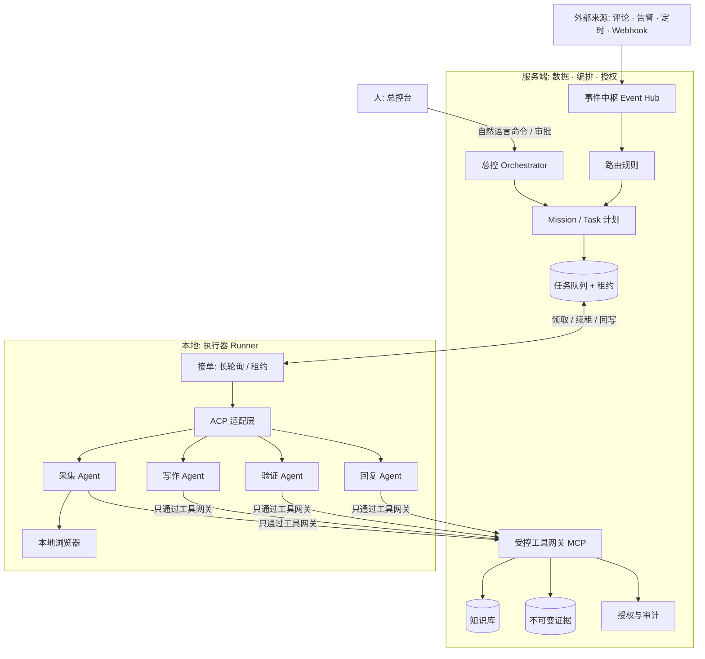
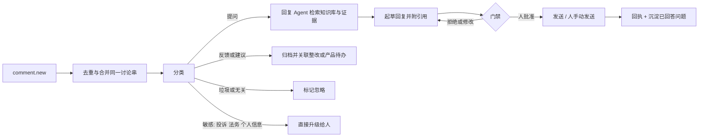

# 多 Agent 协作平台设计提案

> 状态：**设计提案，未实现**。本文不改变任何现有行为、数据契约或部署；实现事实以代码和 `docs/architecture.md` 为准。
> 记录日期：2026-11-05
> 调研代码基准：`18fbacc`（`main`）

## 1. 蓝图

把 ZZ Geo 从“监测与报告工作台”扩展为**多 Agent 协作平台 + 知识库**：

- 人在**总控**下发命令（自然语言），平台拆成任务，交给合适的 Agent。
- Agent 自动**采集**，基于知识库**写文章**，**自动验证**效果，并**回复用户在文章下的提问**。
- 人只处理必须由人决定的事，其余自动完成并留下完整证据。
- 服务端只负责**存数据、编排和授权**；执行尽量放在**本地**，用 ACP（Agent Client Protocol）控制 Agent。

驱动这个方向的三类输入：

1. 公众号与 X 的读者留言：“采集怎么做”“效果怎么样”“只监控网站文章不够，GEO 是多场景内容输出”。
2. 作者回复里已经提到的方向：本地客户端 + ACP + 浏览器操作，贴近真实用户并降低成本；24 小时监控；外挂知识库；文章自动产出。
3. 参考实践：事件统一格式 + 规则路由、本地 Agent 主动接单、每个任务配专属 skill、审查只读且有轮数上限、只把必须决策的事推给人（见 §14）。

## 2. 红线（不因新功能放宽）

以下是现有系统已经成立的规则，新平台必须继承：

- **原始证据不可变。** `query_captures` 与其对象只新增不覆盖；解析变了就重算派生数据。
- **口径透明。** API 采样、浏览器采样、消费端 App 是不同口径，不得混进同一冻结批次或趋势。API 结果不冒充消费端回答。
- **失败不是零分。** 失败、未知、缺失单独计入覆盖率，不用合成数据补齐。
- **同配置复测。** 复测必须复用基线完整 `config`。
- **不自动对外。** 发布文章、回复用户、修改客户网站等对外动作，默认需要人工批准。不保存第三方账号密码或 Cookie。
- **不编造。** 不内置示例客户、行业默认值、虚构回答或指标。
- **不承诺因果。** 任何自动验证都只说明“同条件下的变化”，不声称内容改动导致了收录或排名。

## 3. 现状：可以复用的，和缺口

以下均来自当前代码与文档，不是规划。

### 3.1 已有，可直接复用

| 能力 | 现状 | 事实源 |
| --- | --- | --- |
| 任务队列与租约 | 数据库 job + 租约；Capture 任务租约 300 秒、每 60 秒续租；语义/质检任务 5 分钟租约、两次技术尝试；耗尽租约由清扫收敛 | `apps/worker/src/cloud-runner.ts`，`docs/architecture.md` |
| 桌面端本地 Agent | 桌面会话由客户端用 60 秒租约领取回合，每 20 秒续租；服务端以 `desktop_agent_tool_calls(session_id, tool_call_id)` 保存工具幂等结果，崩溃后可恢复未完成工具结果 | `docs/architecture.md`「AI 工作台」 |
| 受控工具 RPC | Agent 只能调用服务端登记的业务工具（出题、建批次、官网审计、诊断、草稿、报告推进、文章生成、证据读取、联网搜索）；没有 shell、任意文件、任意 SQL、开放 HTTP | `docs/architecture.md`「不变量 / Agent 最小权限」 |
| 授权内核 | 机构上限 → 角色 → 用户 → 客户范围；逐工具策略；后台执行者逐回合、逐工具重验；未登记默认拒绝 | `docs/rbac-v2.md` |
| 知识资产 | 客户级资料：出处、有效期、类型化内容、不可变修订、批准/撤回/归档历史；只有当前、已批准、未过期的修订能支撑新质检 | `docs/content-operations.md` |
| 文章与质检 | 不可变文章版本；独立的编辑审核与质量审核；质检冻结文章、证据、知识修订、模型与策略 | `docs/content-operations.md` |
| 人工发布 | 渠道/账号、版本工单、执行人、回执、复核；系统不对外发布 | `docs/content-operations.md` |
| 整改验收 | 技术类重跑审计，内容类发布后重抓；“已验收”只能由验收动作写入 | `docs/architecture.md`「核心流程」第 8 条 |
| 审批与自动审批 | 工作台自动批准只作用于该会话产生的草稿，带 `sessionId` 审计 | `docs/architecture.md`「AI 工作台」 |

### 3.2 缺口

1. **没有通用的“总控 → 任务 → 多 Agent”编排层。** 现有 AI 工作台是单会话、单 Agent 的流程驱动。
2. **本地执行只有 pi-agent-core 一种。** 仓库里没有 ACP 代码，也没有让本地 Claude Code / Codex 等 Agent 接单的机制。
3. **没有事件统一格式与路由规则。** 触发点是代码里写死的（协调器每 5 秒轮询）。
4. **没有浏览器采样。** 采集只调用五家供应商的联网 API；App/浏览器渠道是 `not_configured`。
5. **知识库只是“可被文章生成读取的有限资料”**，没有检索层，也没有“已回答问题”的沉淀。
6. **没有评论/回复闭环。** 没有评论来源、分类、回复草稿或回执的数据模型。
7. **没有发布后的自动验证流程。** 有整改验收，但没有“文章上线 → 定向复测 → 对比”的闭环。

## 4. 总体架构



三条原则：

1. **服务端是唯一事实源。** Runner 不直连数据库、对象存储或任意 HTTP，所有读写经过受控工具网关。
2. **本地只执行，不决策权限。** 授权、预算、门禁都在服务端判定；Runner 只拿到本次任务的最小能力。
3. **Runner 可离线。** 任务靠租约领取，Runner 掉线后任务回到队列，已落库的结果不丢。

## 5. 概念模型

| 概念 | 含义 |
| --- | --- |
| **Mission** | 总控下发的一条命令及其意图，例如“本周把客户 A 的问题集在 DeepSeek 和豆包重新采样，并给出需要改的 3 篇文章”。属于一个机构、一个客户。 |
| **Task** | Mission 拆出的最小可执行单元，绑定角色、skill、输入快照、预算和门禁。 |
| **Run** | Task 的一次执行尝试，记录 Runner、Agent、模型、租约、工具调用、产出和成本。 |
| **Event** | 统一格式的信号：`source`、`type`、`subject`、`summary`、回链。来源可以是定时、Webhook、评论、告警或人工命令。 |
| **Role** | Agent 职责：采集、写作、验证、回复、知识整理。每个 Role 有固定的工具白名单与 skill。 |
| **Skill** | 沉淀下来的 SOP（规则、参考、脚本）。改任务行为改 skill，不改执行器。 |
| **Gate** | 必须人工批准的门禁，见 §7。 |

## 6. 总控与事件中枢

### 6.1 总控命令

- 入口：总控台的自然语言输入，也可来自飞书等 IM（只作为通知与审批入口，不是事实源）。
- 总控 Agent 把命令拆成 Mission 与 Task，**先给出计划与预估成本，等人确认后再执行**（成本属于必问类）。
- 计划保存为只追加的 Mission 版本。用户修改计划产生新版本，不改旧版本。

### 6.2 事件统一格式

```json
{
  "source": "comment | schedule | webhook | alert | command",
  "type": "comment.new",
  "organizationId": "...",
  "projectId": "...",
  "subject": { "kind": "article_version", "id": "..." },
  "summary": "一句话摘要",
  "link": "回到原处的链接",
  "dedupeKey": "来源内唯一键"
}
```

### 6.3 路由规则

规则是**数据库里带版本的记录**，不是散落在代码里的 if：

- `when`：来源、类型、项目范围。
- `to`：Role、skill、模型、推理强度。
- `group` / `parallel`：同一对象同时只跑一轮；同类任务最多并行 N 个。
- `tell`：何时通知人（`needed` 只在必须决策时通知）。

好处：接一种新事件，加一条规则；换模型，改一行；规则的修改要审批并写审计。

### 6.4 去重与合并

同一事件被重复投递是常态。以 `(organizationId, source, dedupeKey)` 去重；同一对象在窗口内的多条事件合并成一个 Task，避免多个 Agent 改同一件事。

### 6.5 单一出口

所有需要人决策的事只走一条通道：总控台待办（可镜像到 IM）。每个 Gate 有固定类别、上限和静默时段，避免刷屏。

## 7. 门禁（必须人工批准的事）

沿用“草稿审批”的思路，并明确列出类别。以下**永远**需要人：

- 对外发送内容：发布文章、回复评论、发邮件。
- 花钱：超过预算的采集/生成，新增付费渠道。
- 数据：删除、封档、导出客户数据。
- 权限与密钥：创建或轮换密钥、改角色、新增 Runner。
- 改产品方向或改规则：路由规则、门禁规则本身。

可自动完成（仍留证据）：在预算内的采集、解析、质检、草稿生成、验证性重抓。

**已决定的事不再重复问。** 用户批准或拒绝的决定，连同原话与日期，写入项目级决策记录；Agent 在相同情境下直接引用，不再推送。（决策记录属于知识库的一类，见 §10。）

## 8. 本地 Runner 与 ACP

### 8.1 Runner 职责

- **注册**：设备令牌绑定机构与创建者，声明能力（可用 Agent、模型、浏览器、并发上限）。令牌可撤销。
- **接单**：向服务端长轮询领取任务（一次最长约 50 秒，无任务再挂起），不需要暴露公网端口。
- **租约**：沿用现有模式，领取即获租约，周期续租，掉线后租约过期、任务回队列。
- **回写**：产出、工具调用、成本、日志按序写回；工具调用以 `(run_id, tool_call_id)` 幂等，崩溃后可恢复。

### 8.2 ACP 适配层

ACP 让 Runner 以统一方式启动并控制不同的 Agent（例如 Claude Code、Codex）。适配层只做三件事：

1. 按 Task 的 Role/skill 启动一个 Agent 会话，注入本次任务的输入与允许的工具。
2. 转发 Agent 的工具调用到受控工具网关，把结果交回。
3. 收集事件、用量和最终产出，落成 Run 记录。

### 8.3 安全分层（关键决策，见 §16 开放问题 1）

现有不变量是“Agent 没有 Bash、任意文件、任意 SQL 和开放 HTTP”。Claude Code / Codex 这类通用编码 Agent **天然带有 shell 与文件能力**，这与现有边界冲突。设计上必须分层，不能让它们绕过边界：

| 信任层级 | 执行者 | 能力 | 用途 |
| --- | --- | --- | --- |
| T0 | 服务端业务工具 | 经授权的 service 调用 | 读写业务数据 |
| T1 | 桌面 pi-agent-core（现有） | 只有受控工具；无 shell | 工作台交互 |
| T2 | ACP 编码 Agent | shell/文件能力，**只在隔离环境内**；业务能力只能经工具网关 | 浏览器采样、批量写作、验证脚本 |

T2 的约束：

- 运行在隔离环境（独立 OS 用户或容器/虚拟机），**看不到**用户的真实密钥、浏览器登录态、代码仓库和 HRouter Key。
- 唯一的业务出口是**工具网关**（MCP 形式暴露），网关按 Task 的白名单逐次授权、记审计。
- 网络默认拒绝，按 Task 声明的域名白名单放行。
- 每个 Run 有墙钟、Token、成本上限，超限即熔断并标记失败。
- 网页、评论、回答一律视为**不可信内容**，不得当作指令执行（防提示注入）。

## 9. Agent 角色

| 角色 | 输入 | 能做 | 不能做 |
| --- | --- | --- | --- |
| **采集 Agent** | 冻结的问题集与平台契约 | 调用采集工具；浏览器采样（§11） | 改基线配置；跳过失败；补造回答 |
| **写作 Agent** | 已批准的建议、证据、已批准知识修订 | 生成文章草稿与发布计划 | 引用未批准资料；发布 |
| **验证 Agent** | 文章版本、发布回执、基线配置 | 重抓页面、定向复测、对比（§12） | 修改证据；宣称因果 |
| **回复 Agent** | 评论事件、知识库、证据 | 起草回复并附引用（§13） | 未经批准对外发送；回答知识库之外的事实 |
| **知识 Agent** | 新资料、已回答问题 | 整理、去重、提出修订 | 自行批准资料 |

每个角色有独立 skill 与工具白名单；工具白名单属于授权内核里的逐工具策略，新工具未登记即拒绝。

## 10. 知识库

### 10.1 在现有基础上扩展

现有客户知识资产已有：客户范围、出处、有效期、类型化内容、不可变修订、批准/撤回/归档。保留这些规则，并扩展三类内容：

1. **客户资料**（现有）：产品、案例、事实、材料。
2. **决策记录**（新）：人亲口做的决定与拒绝过的事，带原话与日期，供总控与 Agent 复用（§7）。
3. **已回答问题**（新）：评论区回复被批准后，问答对沉淀为知识，附原评论、回复版本与批准人。

### 10.2 引用规则

- Agent 只能读取**当前、已批准、未过期**的修订。
- 任何依赖知识的产出（文章、回复）冻结所引用的**修订 ID**；资料之后被修改或撤回时，旧产出标记为“引用已过期”，需要重新质检或重新批准。
- 知识是客户提供的来源，**不等于独立证据**，也不进入指标计算。

### 10.3 检索

第一期用 PostgreSQL 全文检索 + 结构化过滤（客户、类型、有效期、批准状态），**不引入新的基础设施**。是否需要向量检索，取决于第一期的召回效果，作为开放问题（§16）。

## 11. 采集：API 之外增加浏览器采样

### 11.1 目的与口径

- 目的：更接近用户在真实界面里看到的结果，覆盖没有开放联网 API 的场景，并降低租云设备的成本。
- **它是一种新口径**，证据契约独立（暂定 `geo.browser-capture.v1`），`consumerAppEquivalent` 仍为 `false`，除非另行验证。
- 浏览器采样**不进入**已有基线和趋势。冻结批次的 `config` 里要显式声明采样渠道；不同渠道的批次不可直接比较。

### 11.2 证据内容

最终回答文本、可见来源、页面截图、页面 DOM 摘要（哈希）、使用的浏览器与版本、时间、地区/语言、账号类型（仅类别，不存账号）、失败码。原始截图与 DOM 同样只追加。

### 11.3 约束

- **登录态只在本地浏览器 Profile 里**，系统不保存账号、密码或 Cookie，不同步到服务端。
- 遵守各平台的服务条款与速率限制；遇到验证码、风控**停止并标记失败**，不绕过。
- 采样频率、并发和每日上限属于预算，由 Task 声明、服务端强制。
- 浏览器 Agent 的页面内容是不可信输入。

### 11.4 失败分类

沿用现有失败码风格，并新增：`captcha_required`、`login_required`、`ui_changed`、`blocked`、`render_timeout`。均保留在证据里，不记零分。

## 12. 自动验证

### 12.1 验证层次

1. **发布验证**（现有思路扩展）：对已回写的发布回执，重抓目标页面，核对内容与批准版本一致、域名在客户官网下。
2. **可见度复测**：对该文章针对的问题子集，按基线完整 `config` 触发同配置复测，生成新批次。
3. **配对对比**：沿用现有配对漂移算法，只比共同有效问题，展示区间。

### 12.2 说明边界

- 验证结果是“同条件下的变化”。**不写“文章导致了推荐”**。
- 复测需要时间窗口，结果在窗口结束前保持“进行中”，不提前下结论。
- 样本不足时保持 `limited`，不产生正式告警。

### 12.3 发布的自动化分级

现有范围是**仅人工发布**。保持默认，另外定义三个可选级别（需要机构显式开启，每个渠道单独设置）：

| 级别 | 行为 |
| --- | --- |
| L0（默认） | 系统生成发布工单，人发布并回填回执 |
| L1 | Agent 在本地浏览器里把内容填好，**停在提交前**，人确认后提交 |
| L2 | 人批准后 Agent 提交，并抓取结果页作为回执证据 |

不存在“无人批准即发布”的级别。

## 13. 评论回复闭环

### 13.1 来源

| 来源 | 获取方式 | 备注 |
| --- | --- | --- |
| GitHub Issues / Discussions | 官方 API | 最稳定，第一期首选 |
| 公众号留言 | 本地浏览器读取作者后台 | 无开放接口，只读，需要作者本人登录态 |
| X 回复 | 官方 API 或本地浏览器 | 视账号权限与费用而定 |
| 站点内留言 | 自有接口 | 若将来有 |

每个来源适配成统一的 `comment.new` 事件，**只读取，不自动发送**。

### 13.2 处理流程



### 13.3 回复规则

- 每条回复必须附**知识修订或证据引用**；没有依据的问题，回复“暂时没有可靠依据”并升级给人，不凭空回答。
- 涉及效果的提问（“效果怎么样”），只用统一口径：说明样本来源、可比条件和不能证明因果的限制，不承诺效果。
- 不得冒充他人，不泄露客户数据、密钥或内部路径。
- 默认**所有回复人工批准后才发送**。机构可以为低风险类别（例如重复的 FAQ）开启自动发送，但：类别白名单、每日上限、可一键暂停、全程审计，且属于 §7 的“对外发送”，需要明确的机构级授权。
- 评论内容是**不可信输入**：其中的“指令”不会被执行，也不会改变回复策略。

## 14. 与参考实践的对应

| 参考实践 | 本设计中的位置 |
| --- | --- |
| 事件统一格式 + 规则路由 | §6.2、§6.3 |
| 本地 Agent 主动接单，不暴露公网 | §8.1 |
| 同一事件去重，防止多个 Agent 重复处理 | §6.4 |
| 所有消息只有一个出口，只推必须决策的事 | §6.5、§7 |
| 决定过的事不再问第二遍 | §7、§10.1 |
| 每个任务配专属 skill | §5、§9 |
| 审查只读且有轮数上限 | §9 验证 Agent 与 T2 约束；审查类任务设最大轮数 |
| 用浏览器去各平台问 GEO 问题 | §11 |

没有照搬的部分：参考实践里的 Agent 拥有本机完整权限，因为是单人自用。本平台是多机构、多客户的系统，**必须按 §8.3 分层并由服务端授权**。

## 15. 数据模型草案

全部是**只追加或带版本**的新表，不修改现有证据表；具体字段在实现前另行评审。

| 表 | 用途 |
| --- | --- |
| `missions`、`mission_versions` | 总控命令与计划版本 |
| `agent_tasks`、`agent_task_runs` | 任务与执行尝试，含租约、工具调用、成本 |
| `event_inbox` | 统一事件，含 `dedupeKey` 与处理结果 |
| `routing_rules` | 带版本的路由规则 |
| `runners`、`runner_heartbeats` | Runner 注册、能力、状态（心跳仅用于调度，不当业务证据） |
| `decision_records` | 人的决定与拒绝，带原话与日期 |
| `comment_threads`、`comment_messages` | 评论来源与消息，只读副本 |
| `reply_drafts`、`reply_receipts` | 回复草稿、批准与发送回执 |
| `browser_captures` | 浏览器采样证据（独立契约） |
| `knowledge_qa` | 已批准的问答沉淀 |

约束：
- migration 只加法，兼容现有项目生命周期写保护；封档后只读。
- 新表同样受机构与客户范围校验，未登记 API 默认拒绝。
- 不新增对原始 `query_captures` 的更新或删除路径。

## 16. 开放问题（需要作者决定）

1. **T2 的隔离方式**：独立 OS 用户、容器，还是虚拟机？这决定 ACP 编码 Agent 能否在不破坏“无 shell”不变量的前提下使用。
2. **浏览器采样是否进入正式指标**：建议先只作为独立口径展示，积累标注与对照后再决定是否允许进入正式报告。
3. **评论来源的优先级**：建议先做 GitHub Issues，再做公众号与 X。
4. **自动回复的范围**：是否允许开启 L2 式自动发送，还是始终人工批准。
5. **知识库检索**：全文检索是否够用，是否需要向量检索与新的存储。
6. **成本预算的归属**：Run 的成本由机构共享预算，还是按客户分配。
7. **多机构场景**：Runner 是否允许跨客户复用，还是按客户隔离浏览器 Profile。
8. **通知通道**：总控台之外，是否接入飞书等 IM 作为审批入口，以及卡片里允许出现的信息范围。

## 17. 分期

每一期都必须在**不破坏现有口径与证据**的前提下独立可交付。

| 期 | 范围 | 验收 | 明确不做 |
| --- | --- | --- | --- |
| P0 | 设计评审，确定 §16 的 1–4 | 开放问题有结论并更新本文 | 任何代码 |
| P1 | 事件中枢、路由规则、任务/Run 模型；沿用现有桌面租约机制做首个 Runner | 一个事件能经规则路由到一个本地 Agent 并回写；去重、租约恢复、审计测试通过 | ACP、浏览器采样 |
| P2 | ACP 适配层 + T2 隔离 + 工具网关 | ACP Agent 只能经网关访问业务；越权与超限测试通过 | 浏览器采样入指标 |
| P3 | 浏览器采样证据契约 + 采集 Agent | 新口径独立展示，不混入旧基线；失败分类与证据留存测试通过 | 绕过验证码或风控 |
| P4 | 评论回复闭环（人工批准） + 已回答问题沉淀 | 一条评论能走到“草稿带引用 → 人批准 → 回执 → 沉淀” | 无人批准的自动发送 |
| P5 | 自动验证闭环 + 知识库检索 | 发布回执触发定向复测并生成配对对比 | 宣称因果 |

## 18. 实现时的影响面（防飘逸）

本文是设计提案，没有触发防飘逸检查。进入实现后每一期都属于重大功能变更，需要按 `.agents/skills/geo-development/references/drift-control.md` 同步：

- **architecture**：新增服务/调用链、Runner、工具网关。
- **domain**：新表、证据契约、job type、状态机、租约与重试语义、浏览器采样口径。
- **provider**：浏览器渠道的协议、失败分类与口径披露。
- **operations / deployment**：Runner 的安装、升级、回滚、备份与恢复；Compose 拓扑变化。
- **capability**：`docs/capability-matrix.md` 里新增的能力与证据边界。

对应的测试至少包括：租约与幂等、越权与超限、提示注入（评论与网页）、证据不可变、不同口径不可比较、门禁不可绕过、离线恢复。真实模型与真实平台的行为需要在隔离环境单独验收，不能用合成夹具代替。
