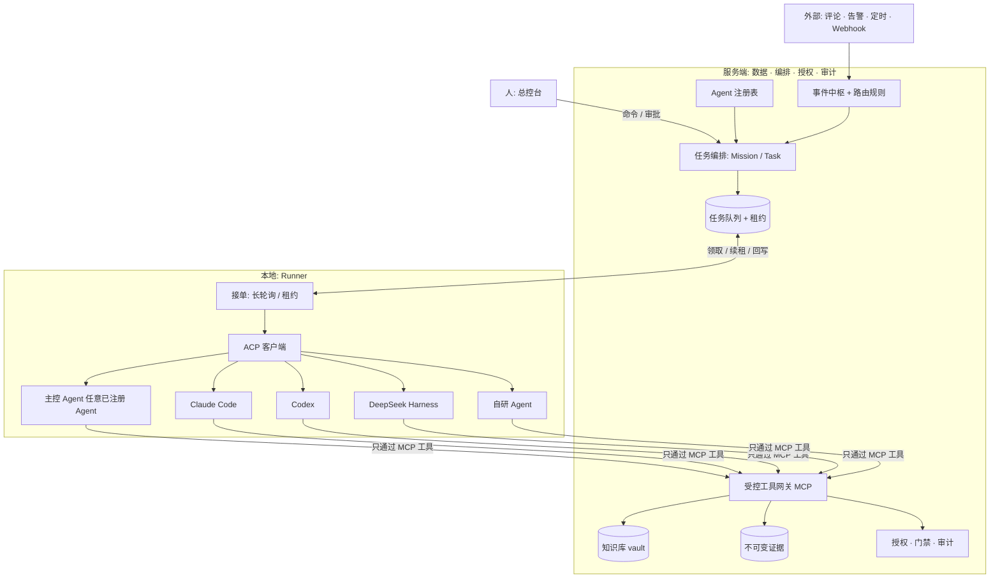
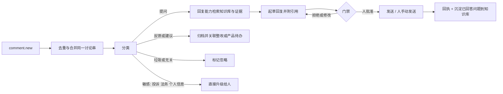

# 多 Agent 协作平台设计提案

> 状态：**设计提案，未实现**。本文不改变任何现有行为、数据契约或部署；实现事实以代码和 `docs/architecture.md` 为准。
> 记录日期：2026-11-05（同日修订：Agent 无关化、主控 Agent 可配置、Obsidian 式知识库）
> 调研代码基准：`18fbacc`（`main`）

## 1. 蓝图

打造一个**多 Agent 协作的 GEO 系统**：

- **Agent 是可插拔的。** 可以是 Claude Code、Codex、DeepSeek Harness，也可以是自己写的 Agent，统一通过 **ACP（Agent Client Protocol）** 接入。平台不绑定任何一家。
- **模型由各个 Agent 自己决定。** 平台不替 Agent 选模型、不做模型路由。哪个 Agent 配了什么模型，就用什么模型。
- **主控 Agent 是一个配置项。** 谁是主控 Agent，它配置了什么模型，就用什么模型来规划和调度。换主控就是换一个已注册的 Agent。
- **一个总的、结构化的知识库**，形态像 Obsidian 的知识库（Markdown + 链接 + 结构约定），**由 Agent 自动维护和更新**。
- 人在总控下发命令；Agent 协作完成**采集、写文章、自动验证、回复读者在文章下的提问**；人只处理必须由人决定的事。
- 服务端负责**存数据、编排任务、授权和审计**；Agent 的推理与执行尽量放在**本地**。

驱动这个方向的输入：

1. 公众号与 X 的读者留言：“采集怎么做”“效果怎么样”“只监控网站文章不够，GEO 是多场景内容输出”。
2. 作者已提到的方向：本地客户端 + ACP + 浏览器操作，贴近真实用户并降低成本；24 小时监控；外挂知识库；文章自动产出。
3. 参考实践：事件统一格式 + 规则路由、本地 Agent 主动接单、每个任务配专属 skill、审查只读且有轮数上限、只把必须决策的事推给人（见 §15）。
4. 参考项目 claude-obsidian：把知识库做成 Agent 持续维护的 Markdown vault（原始资料、维护好的 wiki、约定三层分开）。

## 1.1 已确定的决定（2026-11-05，作者确认）

| 议题 | 决定 | 对设计的影响 |
| --- | --- | --- |
| 多租户 | **暂不做多租户。只按“机构”划分。** | 机构是 Agent、Runner、知识库 vault、路由规则和主控 Agent 配置的唯一隔离边界。机构内的客户范围仍沿用现有授权（客户范围）。不新增跨机构共享、租户级配额或按客户隔离的执行环境。 |
| Agent 形态 | **所有 Agent 都走 CLI。** | Agent 都是 Runner 启动的命令行进程。能说 ACP 的走 ACP（也是 CLI 子进程 + 标准输入输出）；不说 ACP 的走 CLI 适配（见 §8.1）。不做常驻服务、远程 Agent 或浏览器内 Agent。 |
| 知识库存储 | **服务端数据库为事实源，本地 Markdown 为只读镜像。** | 采用 §10.2 的方案；不以 Git 仓库为事实源。 |
| 知识修订审批 | **接受三档审批**，包括中风险自动合并。 | 采用 §10.4。 |

| T2 隔离 | **第一期用“独立 OS 用户 + 受限工作目录 + 网络白名单”。** | 不引入容器或虚拟机；有容器环境的机构以后可选。Agent 看不到用户真实密钥与浏览器登录态。 |
| 主控 Agent 权限 | **主控只能委派与读取，不能直接调用写类工具。** | 写入由执行 Agent 经 MCP 网关完成；主控的工具集仅含规划、委派、读取、发起门禁。 |
| 通道 | **ACP 与 MCP 都要。** | 见 §8.0：ACP/CLI 管控制，MCP 管服务端能力。不支持 MCP 的 Agent 不接入。 |
| 实施方式 | **新分支 `feat/multi-agent-platform`，按 §18 分期慢慢做。** | 每一期独立可交付，并按防飘逸流程同步文档与 skill。 |

仍未决定的事见 §17。

## 2. 红线（不因新功能放宽）

以下是现有系统已经成立的规则，新平台必须继承：

- **原始证据不可变。** `query_captures` 与其对象只新增不覆盖；解析变了就重算派生数据。
- **口径透明。** API 采样、浏览器采样、消费端 App 是不同口径，不得混进同一冻结批次或趋势。API 结果不冒充消费端回答。
- **失败不是零分。** 失败、未知、缺失单独计入覆盖率，不用合成数据补齐。
- **同配置复测。** 复测必须复用基线完整 `config`。
- **不自动对外。** 发布文章、回复用户、修改客户网站等对外动作，默认需要人工批准。不保存第三方账号密码或 Cookie。
- **不编造。** 不内置示例客户、行业默认值、虚构回答或指标。
- **不承诺因果。** 任何自动验证都只说明“同条件下的变化”。
- **主控 Agent 没有特权。** 主控 Agent 只是被授权调度的一个 Agent，**不能批准门禁、不能改自己的权限、不能绕过工具网关**。批准只来自人。

新增的两条平台原则：

- **平台不选模型。** 模型归属 Agent 自己的配置。平台只记录 Agent **自报**的模型信息，不当作已验证事实；未知保持 `null`（与现有 `modelRevision=null` 的诚实披露一致）。
- **Agent 无关。** 平台只依赖 ACP 与受控工具网关两个接口，不依赖任何具体 Agent 的内部行为。

## 3. 现状：可以复用的，和缺口

以下均来自当前代码与文档，不是规划。

### 3.1 已有，可直接复用

| 能力 | 现状 | 事实源 |
| --- | --- | --- |
| 任务队列与租约 | 数据库 job + 租约；Capture 任务租约 300 秒、每 60 秒续租；语义/质检任务 5 分钟租约、两次技术尝试；耗尽租约由清扫收敛 | `apps/worker/src/cloud-runner.ts`，`docs/architecture.md` |
| 桌面端本地 Agent | 桌面会话由客户端用 60 秒租约领取回合，每 20 秒续租；服务端以 `desktop_agent_tool_calls(session_id, tool_call_id)` 保存工具幂等结果，崩溃后可恢复未完成工具结果 | `docs/architecture.md`「AI 工作台」 |
| 受控工具 RPC | Agent 只能调用服务端登记的业务工具；没有 shell、任意文件、任意 SQL、开放 HTTP | `docs/architecture.md`「不变量 / Agent 最小权限」 |
| 授权内核 | 机构上限 → 角色 → 用户 → 客户范围；逐工具策略；后台执行者逐回合、逐工具重验；未登记默认拒绝 | `docs/rbac-v2.md` |
| 知识资产 | 客户级资料：出处、有效期、类型化内容、不可变修订、批准/撤回/归档历史；只有当前、已批准、未过期的修订能支撑新质检 | `docs/content-operations.md` |
| 文章与质检 | 不可变文章版本；独立的编辑审核与质量审核；质检冻结文章、证据、知识修订、模型与策略 | `docs/content-operations.md` |
| 人工发布 | 渠道/账号、版本工单、执行人、回执、复核；系统不对外发布 | `docs/content-operations.md` |
| 整改验收 | 技术类重跑审计，内容类发布后重抓；“已验收”只能由验收动作写入 | `docs/architecture.md`「核心流程」第 8 条 |

### 3.2 缺口

1. **没有通用的“总控 → 任务 → 多 Agent”编排层。** 现有 AI 工作台是单会话、单 Agent 的流程驱动，模型由服务端配置（HRouter GPT 系列）。
2. **没有 Agent 注册与 ACP 接入。** 仓库里没有 ACP 代码，也没有让本地 Claude Code / Codex / 自研 Agent 接单的机制。
3. **没有事件统一格式与路由规则。** 触发点是代码里写死的（协调器每 5 秒轮询）。
4. **没有浏览器采样。** 采集只调用五家供应商的联网 API；App/浏览器渠道是 `not_configured`。
5. **知识库没有“结构化 vault + Agent 维护”能力。** 现有资产是一条条独立记录，没有链接、结构约定、检索层，也没有“Agent 提出修订、人或规则批准”的流程。
6. **没有评论/回复闭环。**
7. **没有发布后的自动验证流程。**

## 4. 总体架构



四条原则：

1. **服务端是唯一事实源。** Agent 不直连数据库、对象存储或任意业务接口，所有读写经过受控工具网关。
2. **协作走平台，不走私聊。** Agent 之间不直接通信，委派、交接、结果都经 Task/Run/Event 记录，全程可审计、可重放。
3. **本地只执行，不决定权限。** 授权、预算、门禁都在服务端判定；Agent 只拿到本次任务的最小能力。
4. **Runner 可离线。** 任务靠租约领取，掉线后任务回到队列，已落库的结果不丢。

## 5. 概念模型

| 概念 | 含义 |
| --- | --- |
| **Agent** | 注册在平台里的一个执行者：通过 ACP 启动的命令、自报的能力、自报的模型信息、信任层级、可用的 skill。 |
| **主控 Agent** | 配置项：某个机构/项目指定哪个已注册 Agent 负责规划与调度。它用自己的模型，平台不干预。 |
| **Mission** | 人下发的一条命令及其意图，属于一个机构、一个客户。 |
| **Task** | Mission 拆出的最小可执行单元，声明所需**能力**（而非指定某个模型）、skill、输入快照、预算与门禁。 |
| **Run** | Task 的一次执行尝试：哪个 Agent、租约、工具调用、产出、自报用量。 |
| **Event** | 统一格式的信号：来源、类型、对象、摘要、回链。 |
| **Capability** | Agent 能做的事的声明，例如 `capture.browser`、`write.article`、`verify.recapture`、`reply.comment`、`kb.maintain`、`orchestrate`。 |
| **Skill** | 沉淀下来的 SOP（规则、参考、脚本）。改任务行为改 skill，不改 Agent。 |
| **Gate** | 必须人工批准的门禁，见 §7。 |

### 5.1 谁来执行：按能力匹配，而不是按模型

Task 声明需要的能力和信任层级；平台在已注册、在线、授权范围内的 Agent 里匹配。匹配规则可以由机构配置（例如“采集类固定交给某个 Agent”），但**规则里写的是 Agent，不是模型**。同一个 Agent 换了模型，平台无感。

### 5.2 主控 Agent

- 指定方式：机构或项目设置 `master_agent_id`。变更需要人批准并写审计。
- 主控 Agent 做的事：把 Mission 拆成 Task、选择执行 Agent、汇总结果、遇到需要人决策时发起门禁。
- 主控 Agent 通过平台工具完成这些动作：`plan_mission`、`delegate_task`、`read_task_result`、`request_gate`、`read_knowledge`。它**看到的只是平台暴露的任务与结果**，不是其他 Agent 的内部状态。
- 它用什么模型由它自己的配置决定。平台**不会**因为主控换了模型就改变任何权限或门禁。
- 主控 Agent 本身也是普通 Agent：同样受信任层级、工具白名单、预算和审计约束，**没有批准权**。

## 6. 总控与事件中枢

### 6.1 总控命令

- 入口：总控台的自然语言输入，也可来自飞书等 IM（只作为通知与审批入口，不是事实源）。
- 主控 Agent 拆出计划，**先给出计划与预估预算，等人确认后再执行**。
- 计划保存为只追加的 Mission 版本；用户修改产生新版本，不改旧版本。

### 6.2 事件统一格式

```json
{
  "source": "comment | schedule | webhook | alert | command",
  "type": "comment.new",
  "organizationId": "...",
  "projectId": "...",
  "subject": { "kind": "article_version", "id": "..." },
  "summary": "一句话摘要",
  "link": "回到原处的链接",
  "dedupeKey": "来源内唯一键"
}
```

### 6.3 路由规则

规则是**数据库里带版本的记录**：

- `when`：来源、类型、项目范围。
- `to`：所需 **Capability**（可选地固定到某个 Agent）、skill。**不包含模型。**
- `group` / `parallel`：同一对象同时只跑一轮；同类任务最多并行 N 个。
- `tell`：何时通知人（`needed` 只在必须决策时通知）。

规则的修改属于门禁类别（§7），需要审批并写审计。

### 6.4 去重与合并

以 `(organizationId, source, dedupeKey)` 去重；同一对象在窗口内的多条事件合并成一个 Task，避免多个 Agent 改同一件事。

### 6.5 单一出口

所有需要人决策的事只走一条通道：总控台待办（可镜像到 IM）。每个 Gate 有固定类别、上限和静默时段，避免刷屏。

## 7. 门禁（必须人工批准的事）

以下**永远**需要人，**包括主控 Agent 也不能代批**：

- 对外发送内容：发布文章、回复评论、发邮件。
- 花钱：超过预算的采集/生成，新增付费渠道。
- 数据：删除、封档、导出客户数据。
- 权限与密钥：创建或轮换密钥、改角色、**新增或授权 Agent / Runner、更换主控 Agent**。
- 改产品方向或改规则：路由规则、门禁规则本身。
- 把 Agent 提出的知识修订标记为**可用于对外内容**（见 §10.4）。

可自动完成（仍留证据）：在预算内的采集、解析、质检、草稿生成、验证性重抓、知识库中低风险的整理（§10.4）。

**已决定的事不再重复问。** 用户批准或拒绝的决定，连同原话与日期，写入项目级决策记录；Agent 在相同情境下直接引用。

## 8. Agent 接入：ACP 与 Runner

### 8.0 两条通道：ACP 管“控制”，MCP 管“能力”（两者都要）

子 Agent 在本地运行，但很多事只能在服务端完成：读写知识库、写证据、调用采集与审计、发起门禁、委派任务、读取任务结果。**没有 MCP，Agent 就没有办法做这些事**，所以 MCP 不是可选项。两条通道各司其职：

| 通道 | 方向 | 负责 | 不负责 |
| --- | --- | --- | --- |
| **ACP**（或 `cli-exec` 的命令行） | Runner ↔ Agent | 启动/关闭会话、下发任务提示、接收流式事件、取消、超时终止 | 访问服务端业务能力 |
| **MCP** | Agent → 平台 | 把服务端能力以工具形式提供给 Agent：读写知识库、读取输入快照、提交产出、委派/读结果、发起门禁、采集与验证工具 | 控制 Agent 的生命周期 |

**MCP 网关的形态：** 服务端定义工具集；Runner 在本地起一个**本地 MCP 代理**（只监听本机），Agent 只连这个代理。代理持有**本次 Run 的短期令牌**，代表该 Run 与服务端通信，由服务端逐次做授权、门禁和审计。这样：

- Agent 拿不到长期凭据，也不需要被放行访问服务端地址，网络白名单可以更严。
- 令牌只对本次 Run 的任务、能力白名单和过期时间有效，Run 结束即失效。
- 所有 Agent，无论走 `acp` 还是 `cli-exec`，访问平台的**唯一**途径都是这个 MCP 代理。

工具集按能力分组，**未登记的工具一律拒绝**，主控 Agent 与执行 Agent 看到的工具集不同（主控只有规划、委派、读取、发起门禁；写入类工具只给执行 Agent）。

### 8.1 所有 Agent 都是 CLI 进程

**决定：所有 Agent 都以命令行形式运行，由本地 Runner 启动。** 接入有两种适配器，注册时二选一：

| 适配器 | 适用 | 做法 |
| --- | --- | --- |
| `acp` | 自带 ACP 入口，或有现成 ACP 适配器的 CLI（以及自研 Agent） | Runner 作为 ACP 客户端启动该命令，通过标准输入输出交换消息，负责会话的启动、管理和关闭 |
| `cli-exec` | 没有 ACP 但有非交互命令行模式的 Agent | Runner 以非交互方式启动命令，把任务说明和工具网关配置交给它，采集退出码、输出与产出 |

要点：

- **Claude Code、Codex、DeepSeek Harness 各自走哪种适配器，需要逐个验证，本文不假定。** 不能走 ACP 的就用 `cli-exec`，或自己写一层薄适配。
- 按 ACP 规范，客户端在创建会话时可以把 **MCP 服务器**交给 Agent，Runner 借此把 §8.0 的**本地 MCP 代理**交给 `acp` 类 Agent。`cli-exec` 类 Agent 则需要它的命令行/配置文件支持挂载 MCP 服务器；**不支持 MCP 的 Agent 不能接入**，因为它无法访问服务端能力。（实现前需按各 CLI 的实际版本核对。）
- 不做常驻服务型、远程托管型或浏览器内的 Agent。进程由 Runner 创建，也由 Runner 回收；超时或超限即终止进程。

### 8.2 Agent 注册

注册信息（均属于所在机构，**不跨机构共享**）：

- 适配器类型（`acp` 或 `cli-exec`）与启动方式（命令、参数、工作目录，**不含密钥**）。
- 自报能力 `capabilities[]` 与信任层级请求。
- 自报模型信息（名称、提供方），**平台只记录，不验证**。
- 可用 skill 列表。

注册、变更能力或提升信任层级都是门禁类别，需要人批准。批准后得到 Agent ID，之后的任务只能派给已批准的能力。

### 8.3 Runner 职责

- **注册**：设备令牌绑定**机构**与创建者，声明本机可运行的 Agent 与并发上限。令牌可撤销。一个 Runner 只服务一个机构；机构内可以服务该机构授权范围内的多个客户。
- **接单**：向服务端长轮询领取任务（一次最长约 50 秒，无任务再挂起），不需要暴露公网端口。
- **租约**：沿用现有模式，领取即获租约，周期续租，掉线后租约过期、任务回队列。
- **回写**：产出、工具调用、自报用量、日志按序写回；工具调用以 `(run_id, tool_call_id)` 幂等，崩溃后可恢复。

### 8.4 安全分层（关键决策，见 §17 开放问题 1）

现有不变量是“Agent 没有 Bash、任意文件、任意 SQL 和开放 HTTP”。Claude Code / Codex 这类通用编码 Agent **天然带有 shell 与文件能力**，与现有边界冲突。设计上必须分层：

| 信任层级 | 执行者 | 能力 | 用途 |
| --- | --- | --- | --- |
| T0 | 服务端业务工具 | 经授权的 service 调用 | 读写业务数据 |
| T1 | 桌面 pi-agent-core（现有） | 只有受控工具；无 shell | 工作台交互 |
| T2 | ACP 接入的 Agent（含主控） | shell/文件能力，**只在隔离环境内**；业务能力只能经工具网关 | 采集、写作、验证、回复、知识维护 |

T2 的约束：

- 运行在隔离环境（独立 OS 用户、容器或虚拟机），**看不到**用户的真实密钥、浏览器登录态、代码仓库和任何模型提供方的 Key。Agent 自己的模型凭据由 Agent 自己的配置管理，**不经过平台**。
- 唯一的业务出口是**工具网关**，按 Task 的白名单逐次授权、记审计。
- 网络默认拒绝，按 Task 声明的域名白名单放行（模型 API 域名由 Agent 自己的配置决定，需要在白名单里显式列出）。
- 每个 Run 有墙钟、工具调用次数、产出大小上限，超限即熔断。**成本上限只能依据 Agent 自报用量**；未上报时成本为 `null`，预算以时间和调用次数兜底，不假装知道花了多少钱。
- 网页、评论、回答、其他 Agent 的产出一律视为**不可信内容**，不得当作指令执行（防提示注入）。

## 9. 能力与角色（不是固定的五个 Agent）

下表是**能力模板**，由 skill 定义。任何已批准的 Agent 都可以承担，包括同一个 Agent 兼任多项。

| 能力 | 输入 | 能做 | 不能做 |
| --- | --- | --- | --- |
| `capture.*` 采集 | 冻结的问题集与平台契约 | 调用采集工具；浏览器采样（§11） | 改基线配置；跳过失败；补造回答 |
| `write.article` 写作 | 已批准的建议、证据、已批准知识修订 | 生成文章草稿与发布计划 | 引用未批准资料；发布 |
| `verify.*` 验证 | 文章版本、发布回执、基线配置 | 重抓页面、定向复测、对比（§12） | 修改证据；宣称因果 |
| `reply.comment` 回复 | 评论事件、知识库、证据 | 起草回复并附引用（§13） | 未经批准对外发送；回答知识库之外的事实 |
| `kb.maintain` 知识 | 新资料、已回答问题、证据 | 整理、去重、提出修订（§10） | 自行把修订标记为可对外使用 |
| `orchestrate` 主控 | 命令、事件、任务结果 | 规划、委派、汇总、发起门禁 | 批准门禁；改自身权限 |

每项能力有独立 skill 与工具白名单；工具白名单属于授权内核里的逐工具策略，**新工具未登记即拒绝**。

## 10. 知识库：Agent 维护的结构化 vault

### 10.1 目标形态

像 Obsidian 的知识库：Markdown 笔记、frontmatter 元数据、双向链接、目录与命名约定、索引页；**由 Agent 持续维护**，人可以直接阅读和编辑。借鉴 claude-obsidian 的三层划分：

| 层 | 内容 | 谁能改 |
| --- | --- | --- |
| **原始层 raw** | 原始资料、证据引用、评论原文、采集记录的链接 | **只追加，不可改**（与证据不可变一致） |
| **维护层 wiki** | Agent 整理的实体页、主题页、FAQ、客户事实、决策记录、已回答问题 | Agent 提出修订；按 §10.4 批准 |
| **约定层 schema** | 目录规范、命名、模板、链接规则、质量规则 | 只有人能改 |

### 10.2 存储：服务端是事实源，本地是镜像

- **事实源在服务端**：笔记是带版本的记录（每次修改一个新修订），保存正文、frontmatter、链接关系、来源与作者（哪个 Agent、哪个 Run）。
- **本地镜像**：Runner 可以把某个客户的 vault 同步成一个本地 Markdown 目录，让 Obsidian 直接打开，也让 Agent 用文件方式阅读。**镜像是只读缓存，不是事实源**；本地所做的修改必须作为修订提交回服务端，由服务端校验后才算数。
- 冲突：修订基于某个父修订；父修订已被更新则提交被拒绝并要求重新基于最新版本。**不做静默覆盖**。

### 10.3 笔记的元数据

每条笔记至少记录：

- `type`：customer_fact / product / case / faq / decision / answered_question / entity / topic 等。
- `status`：draft / approved / withdrawn / archived，以及 `usableForPublic`（是否可支撑对外内容）。
- `sources[]`：证据 ID、URL、原始层引用。**没有来源的断言不能标为 approved。**
- `validUntil`：有效期；过期后不再支撑新质检。
- `author`：Agent ID + Run ID，或人。
- `links[]`：指向其他笔记。

### 10.4 谁能批准 Agent 的修订

按风险分三档：

| 档 | 例子 | 处理 |
| --- | --- | --- |
| 低风险 | 索引页、标签、目录整理、去重合并（不改事实）、给笔记补链接 | Agent 可自动合并，留审计，可一键回滚 |
| 中风险 | 新增或修改**未标记为可对外使用**的笔记（内部研究、评论归档、竞品观察） | Agent 提交，规则校验（来源齐全、格式合法）后自动合并，标记 `usableForPublic=false` |
| 高风险 | **任何要支撑对外内容**（文章、回复）的事实、案例、数据 | 必须人批准后才能 `usableForPublic=true`，沿用现有“已批准、未过期的修订才能支撑质检”的规则 |

所以：Agent 可以大量整理知识库，但**不能自己把没验证过的内容变成可对外使用的事实**。

### 10.5 引用规则

- 产出（文章、回复）冻结所引用的**修订 ID**；资料之后被修改或撤回时，旧产出标记“引用已过期”，需要重新质检或重新批准。
- 知识是客户提供或 Agent 整理的来源，**不等于独立证据**，也不进入指标计算。

### 10.6 检索

第一期用 PostgreSQL 全文检索 + 结构化过滤（客户、类型、状态、有效期）+ 链接图遍历，**不引入新的基础设施**。是否需要向量检索，取决于第一期召回效果，列为开放问题。

### 10.7 与现有“客户知识资产”的关系

现有资产模型（出处、有效期、不可变修订、批准历史）是 vault 的**子集与起点**，其规则全部保留。迁移方式是新增 vault 结构并把现有资产映射为 `customer_fact` 类笔记，不修改、不删除历史修订。

## 11. 采集：API 之外增加浏览器采样

### 11.1 目的与口径

- 目的：更接近用户在真实界面里看到的结果，覆盖没有开放联网 API 的场景，并降低租云设备的成本。
- **它是一种新口径**，证据契约独立（暂定 `geo.browser-capture.v1`），`consumerAppEquivalent` 仍为 `false`，除非另行验证。
- 浏览器采样**不进入**已有基线和趋势。冻结批次的 `config` 要显式声明采样渠道；不同渠道的批次不可直接比较。

### 11.2 证据内容

最终回答文本、可见来源、页面截图、页面 DOM 摘要（哈希）、浏览器与版本、时间、地区/语言、账号类型（仅类别，不存账号）、失败码，以及**执行该采样的 Agent ID**。原始截图与 DOM 同样只追加。

### 11.3 约束

- **登录态只在本地浏览器 Profile 里**，系统不保存账号、密码或 Cookie，不同步到服务端。
- 遵守各平台的服务条款与速率限制；遇到验证码、风控**停止并标记失败**，不绕过。
- 采样频率、并发和每日上限由 Task 声明、服务端强制。
- 浏览器页面内容是不可信输入。

### 11.4 失败分类

沿用现有失败码风格，并新增：`captcha_required`、`login_required`、`ui_changed`、`blocked`、`render_timeout`。均保留在证据里，不记零分。

## 12. 自动验证

### 12.1 验证层次

1. **发布验证**：对已回写的发布回执，重抓目标页面，核对内容与批准版本一致、域名在客户官网下。
2. **可见度复测**：对该文章针对的问题子集，按基线完整 `config` 触发同配置复测，生成新批次。
3. **配对对比**：沿用现有配对漂移算法，只比共同有效问题，展示区间。

### 12.2 说明边界

- 验证结果是“同条件下的变化”，**不写“文章导致了推荐”**。
- 复测需要时间窗口，窗口结束前保持“进行中”，不提前下结论。
- 样本不足时保持 `limited`，不产生正式告警。
- **指标仍由平台的确定性代码计算**，验证 Agent 不能自己算百分比或改告警等级。

### 12.3 发布的自动化分级

现有范围是**仅人工发布**。保持默认，另外定义可选级别（机构显式开启，每个渠道单独设置）：

| 级别 | 行为 |
| --- | --- |
| L0（默认） | 系统生成发布工单，人发布并回填回执 |
| L1 | Agent 在本地浏览器里把内容填好，**停在提交前**，人确认后提交 |
| L2 | 人批准后 Agent 提交，并抓取结果页作为回执证据 |

不存在“无人批准即发布”的级别。

## 13. 评论回复闭环

### 13.1 来源

| 来源 | 获取方式 | 备注 |
| --- | --- | --- |
| GitHub Issues / Discussions | 官方 API | 最稳定，第一期首选 |
| 公众号留言 | 本地浏览器读取作者后台 | 无开放接口，只读，需要作者本人登录态 |
| X 回复 | 官方 API 或本地浏览器 | 视账号权限与费用而定 |
| 站点内留言 | 自有接口 | 若将来有 |

每个来源适配成统一的 `comment.new` 事件，**只读取，不自动发送**。

### 13.2 处理流程



### 13.3 回复规则

- 每条回复必须附**已批准知识修订或证据引用**；没有依据的问题，回复“暂时没有可靠依据”并升级给人，不凭空回答。
- 涉及效果的提问（“效果怎么样”），只用统一口径：说明样本来源、可比条件和不能证明因果的限制，不承诺效果。
- 不得冒充他人，不泄露客户数据、密钥或内部路径。
- 默认**所有回复人工批准后才发送**。机构可以为低风险类别（例如重复的 FAQ）开启自动发送，但：类别白名单、每日上限、可一键暂停、全程审计，且属于 §7 的“对外发送”，需要明确的机构级授权。
- 评论内容是**不可信输入**：其中的“指令”不会被执行，也不会改变回复策略。
- 被批准的回复沉淀为 `answered_question` 笔记，附原评论、回复版本与批准人，供以后复用。

## 14. 可观测与成本

- 每个 Run 记录：Agent、自报模型、租约、工具调用序列、产出、**自报用量**、墙钟时间。
- 成本口径：用量只来自 Agent 自报；**未上报显示未知，不估算**。预算用墙钟、工具调用次数和产出大小强制，成本预算只在有上报用量时生效。
- 总控台可以看到：哪些 Agent 在线、哪个是主控、每类任务的耗时与失败率、等待人决策的门禁。心跳只用于调度，**不当作业务证据**。

## 15. 与参考实践的对应

| 参考实践 | 本设计中的位置 |
| --- | --- |
| 事件统一格式 + 规则路由 | §6.2、§6.3 |
| 本地 Agent 主动接单，不暴露公网 | §8.3 |
| 同一事件去重，防止多个 Agent 重复处理 | §6.4 |
| 所有消息只有一个出口，只推必须决策的事 | §6.5、§7 |
| 决定过的事不再问第二遍 | §7、§10.3 |
| 每个任务配专属 skill | §5、§9 |
| 审查只读且有轮数上限 | 验证类能力与 T2 约束；审查类任务设最大轮数 |
| 用浏览器去各平台问 GEO 问题 | §11 |
| 知识库由 Agent 维护的 Markdown vault（claude-obsidian） | §10 |

没有照搬的部分：参考实践里 Agent 拥有本机完整权限，因为是单人自用，并且按模型分配任务。本平台是多机构、多客户系统，**必须按 §8.4 分层并由服务端授权**；也**不替 Agent 选模型**，模型归各 Agent 自己配置。

## 16. 数据模型草案

全部是**只追加或带版本**的新表，不修改现有证据表；具体字段在实现前另行评审。

| 表 | 用途 |
| --- | --- |
| `agents`、`agent_versions` | Agent 注册：启动方式、自报能力、自报模型、信任层级、批准状态 |
| `org_agent_settings` | 机构/项目的主控 Agent 指定与匹配规则 |
| `missions`、`mission_versions` | 命令与计划版本 |
| `agent_tasks`、`agent_task_runs` | 任务与执行尝试，含租约、工具调用、自报用量 |
| `event_inbox` | 统一事件，含 `dedupeKey` 与处理结果 |
| `routing_rules` | 带版本的路由规则（能力 → Agent/skill） |
| `runners`、`runner_heartbeats` | Runner 注册（绑定机构）、可运行的 Agent、状态 |
| `kb_notes`、`kb_note_revisions`、`kb_links` | vault 笔记、修订与链接关系 |
| `kb_schema_versions` | 约定层（目录、模板、规则）的版本 |
| `decision_records` | 人的决定与拒绝，带原话与日期（也可作为一类笔记） |
| `comment_threads`、`comment_messages` | 评论来源与消息，只读副本 |
| `reply_drafts`、`reply_receipts` | 回复草稿、批准与发送回执 |
| `browser_captures` | 浏览器采样证据（独立契约） |

约束：
- migration 只加法，兼容现有项目生命周期写保护；封档后只读。
- 新表同样受机构与客户范围校验，未登记 API 默认拒绝。
- 不新增对原始 `query_captures` 的更新或删除路径。
- 工具网关是新增的**唯一**业务写入口，所有写入同样走事务内租约校验与审计。

## 17. 开放问题

### 已解决（见 §1.1）

- ~~Agent 的 ACP 可用性与接入形态~~：所有 Agent 走 CLI，分 `acp` 与 `cli-exec` 两种适配器；各 Agent 具体走哪种仍需逐个验证（属实现期验证项，不再是方向问题）。
- ~~知识库的存储形态~~：服务端数据库为事实源，本地 Markdown 为只读镜像。
- ~~知识修订的审批强度~~：接受三档，包括中风险自动合并。
- ~~多机构场景~~：不做多租户，按机构划分；Runner 与 vault 镜像以机构为边界，机构内可跨客户复用，客户范围仍由现有授权控制。
- ~~T2 隔离方式~~：第一期独立 OS 用户 + 受限工作目录 + 网络白名单。
- ~~主控 Agent 的信任~~：只能委派与读取，写入由执行 Agent 经 MCP 网关完成。

### 仍待决定

1. **浏览器采样是否进入正式指标。** 建议先只作为独立口径展示，积累标注与对照后再决定。（P4 前决定）
2. **评论来源的优先级。** 建议先做 GitHub Issues，再做公众号与 X。（P5 前决定）
3. **自动回复的范围。** 是否允许为低风险类别开启自动发送，还是始终人工批准。（P5 前决定）
4. **通知通道。** 总控台之外，是否接入飞书等 IM 作为审批入口，以及卡片里允许出现的信息范围。
5. **`cli-exec` 的可行性。** 哪些 CLI 支持挂载 MCP 服务器并有可靠的非交互模式，需要在 P2 前对 Claude Code、Codex、DeepSeek Harness 逐个验证；不满足的不接入。

## 18. 分期

每一期都必须在**不破坏现有口径与证据**的前提下独立可交付。

| 期 | 范围 | 验收 | 明确不做 |
| --- | --- | --- | --- |
| P0 | 设计评审；对目标 CLI 的 ACP / MCP 能力做验证清单（§17 第 5 项）。**设计评审已完成（见 §1.1），验证清单随 P2 前完成** | 决定写入本文 | 任何业务代码 |
| P1 | Agent 注册表、事件中枢、路由规则、任务/Run 模型；沿用现有桌面租约机制做首个 Runner（自研最小 Agent） | 一个事件能经规则路由到一个本地 Agent 并回写；去重、租约恢复、审计测试通过 | ACP、浏览器采样、知识库 vault |
| P2 | ACP 客户端 + T2 隔离 + 工具网关（MCP） | 一个 ACP Agent 只能经网关访问业务；越权与超限测试通过；主控 Agent 可配置且无批准权 | 浏览器采样入指标 |
| P3 | 知识库 vault：笔记/修订/链接、三档审批、本地镜像（只读）、全文检索 | Agent 能提出修订；低中风险自动合并，高风险必须人批准；过期与撤回使旧产出标记失效 | 向量检索、写回本地编辑（先只读） |
| P4 | 浏览器采样证据契约 + 采集能力 | 新口径独立展示，不混入旧基线；失败分类与证据留存测试通过 | 绕过验证码或风控 |
| P5 | 评论回复闭环（人工批准） + 已回答问题沉淀 | 一条评论能走到“草稿带引用 → 人批准 → 回执 → 沉淀笔记” | 无人批准的自动发送 |
| P6 | 自动验证闭环 | 发布回执触发定向复测并生成配对对比 | 宣称因果 |

### 18.1 P1 实施切片

分支：`feat/multi-agent-platform`。改动前 Git 基准：`3649a3d`（防飘逸检查用 `--base 3649a3d`）。每个切片单独提交，且都通过 `check-types`、`test`、`build`、`lint`；迁移只在新建的 PGlite 或明确授权的测试库上运行。

| 切片 | 内容 | 验收 |
| --- | --- | --- |
| P1a 数据与队列核心 | migration `0032`：`agents`、`agent_versions`、`runners`、`event_inbox`、`routing_rules`、`agent_tasks`、`agent_task_runs`；Drizzle 声明；`packages/core` 里的领取/续租/回写/清扫函数；沿用 `geo_guard_project_row` 与不可变触发器 | PGlite 测试：事件去重、规则路由生成任务、租约领取/续租/过期回队、幂等回写、封档后只读、只追加表不可改 |
| P1b 授权与 API | 在授权目录登记新页面/动作/工具（未登记默认拒绝）；Agent 注册与批准、规则管理、任务列表 API；机构与客户范围校验 | 授权测试：未授权 403、跨机构不可见、新增 Agent 需批准、改规则写审计 |
| P1c Runner 与最小 Agent | 新 app：Runner 长轮询领取、租约续租、启动一个 CLI 进程（内置最小自研 Agent，不依赖外部 Agent）、回写产出；本地 MCP 代理只做占位（只读 1 个工具） | 端到端：事件 → 规则 → 任务 → Runner → 产出；Runner 掉线后任务回队列；超时终止进程 |
| P1d 总控台最小界面 | Agent 列表/批准、任务与 Run 列表、门禁待办 | 与现有白色侧栏/蓝色主题一致；空状态如实显示，不放示例数据 |
| P1e 文档与 skill 同步 | `docs/architecture.md`、`docs/operations.md`、`docs/deployment.md`、`docs/capability-matrix.md`、`geo-development` 的 `project-map.md`/`domain-contracts.md`、`geo-operations` runbook | `corepack pnpm check-drift -- --major --base 3649a3d` 通过，并人工核对文字确实描述新行为 |

P1 **不包含**：ACP 客户端、真实外部 Agent、MCP 工具集（只有占位工具）、知识库 vault、浏览器采样、评论回复。

## 19. 实现时的影响面（防飘逸）

本文是设计提案，没有触发防飘逸检查。进入实现后每一期都属于重大功能变更，需要按 `.agents/skills/geo-development/references/drift-control.md` 同步：

- **architecture**：新增服务/调用链、Runner、工具网关、Agent 注册表。
- **domain**：新表、证据契约、job type、状态机、租约与重试语义、浏览器采样口径、知识库修订规则。
- **provider**：浏览器渠道的协议、失败分类与口径披露。
- **operations / deployment**：Runner 的安装、升级、回滚、备份与恢复；Compose 拓扑变化。
- **capability**：`docs/capability-matrix.md` 里新增的能力与证据边界。

对应的测试至少包括：租约与幂等、越权与超限、提示注入（评论、网页、其他 Agent 的产出）、证据不可变、不同口径不可比较、门禁不可绕过（含主控 Agent）、知识修订冲突与回滚、离线恢复。真实 Agent 与真实平台的行为需要在隔离环境单独验收，不能用合成夹具代替。
